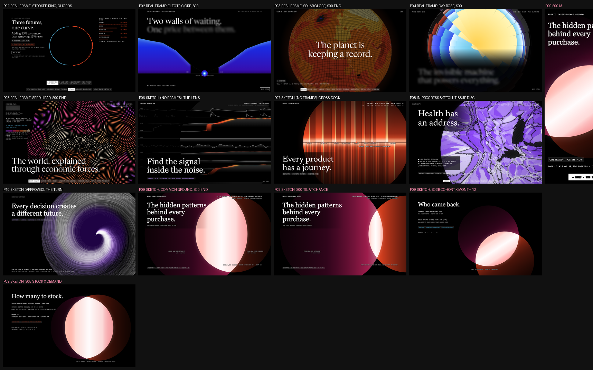
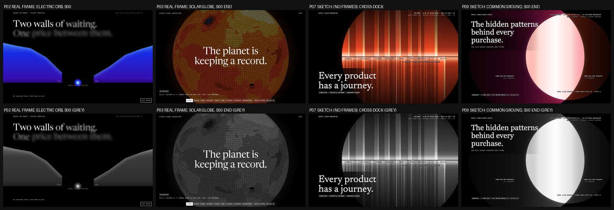

# Visual design: Retail Intelligence Studio ("The Hidden Patterns Behind Every Purchase")

This document covers phases 14-16: reference research, three competing concepts with a scored
selection, and the experience blueprint. The motion bible (phase 17) is `MOTION_SYSTEM.md`.
Author: Creative Director (task P09-CD-001), 2026-10-11.

## Contents

0. [Binding inputs](#0-binding-inputs)
1. [Reference research (phase 14)](#1-reference-research-phase-14)
2. [Three concepts and the selection (phase 15)](#2-three-concepts-and-the-selection-phase-15)
3. [Experience blueprint (phase 16)](#3-experience-blueprint-phase-16)
4. [Signature interactions](#4-signature-interactions)
5. [Copy deck](#5-copy-deck)
6. [Placeholder bindings and data requests](#6-placeholder-bindings-and-data-requests)
7. [Hard rejection criteria](#7-hard-rejection-criteria)

---

## 0. Binding inputs

These are inputs to the design. The design does not choose them.

- **Shared language.** `design/reference-analysis.md`, `design/interaction-inventory.md`, `shared/design-tokens/tokens.css` and `design/fonts/DECISION.md` (workspace root). Fonts: Newsreader (display) and JetBrains Mono (everything else). The ghost-word state is opacity 0.55 plus a 12px blur (ENGINEERING_DECISIONS #10). The viewport class comes from one source shared by CSS and JS (ENGINEERING_DECISIONS #39).
- **What other projects own** (`docs/DESIGN_AUDIT.md`, ENGINEERING_DECISIONS #15-#41, the P06 and P07 VISUAL_DESIGN docs, and the P08 sketches in progress). Evidence I opened for this task:
  - P01 `artifacts/evidence/stage-b3/1440x900/06-futures-a-busier.png` (real frame)
  - P02 `artifacts/evidence/stage-a/1440x900/00-s00-t3600.png` (real frame)
  - P03 `artifacts/evidence/stage-a/1440x900/01-s00-t4600-end.png` (real frame)
  - P04 `artifacts/evidence/stage-b/1440x900/fix1-s00-t3500.png` (real frame; P07 had only a sketch)
  - P05 `artifacts/evidence/stage-a/1440x900/01-s00-t4600-end.png` (real end-of-intro frame; P07 had only a sketch)
  - P06 `design/sketches/lens-s00-d.png` and P07 `design/sketches/dock-s00-d.png` (sketches: neither has build frames yet)
  - P08 `design/sketches/tissue-s00-d.png` (an **in-progress** sketch: P08 has no VISUAL_DESIGN yet, checked 2026-10-11 at P08 commit `74d1c6e`; the file was re-rendered by P08 during this task, and the sheet uses its latest version)
  - P10 `design/sketches/turn-s00-d.png` (the approved P10 sketch; no build frames)

  What each project owns:

  | Project | Owns (do not touch) |
  |---|---|
  | P01 | A 164vw **stroked** ring with nodes on its circumference, chords inside, stepping as a horizon dial; a rising spectral horizon closing; light-blue structure with travelling orange pulses |
  | P02 | Rectilinear depth walls; a smooth **Electric glow orb**, small and oversized, contracting to a marker and growing back |
  | P03 | A **Solar glow orb** resolving into a **sphere of square cells** with a limb; the equal-area unwrap; a vertical core of strata |
  | P04 | A **filled, area-true 24-petal rose**: wedges, black spokes, radial band fills; frame-filling with a lower-left headline |
  | P05 | A **disc of countable grains** on a golden-angle lattice, territories with seams, the **Spectral ramp as a continuous data encoding**; frame-filling with a lower-left headline |
  | P06 | **The Lens**: a giant unstroked circle (an aperture with a glass tint) over horizontal telemetry traces; orange residual light |
  | P07 | **The Cross-Dock**: an area-true disc of vertical bars cut by a horizontal seam; orange settled fills, violet structure |
  | P08 (in progress) | A **tissue disc**: a giant circle partitioned into Voronoi-like polygon cells, purple with white and hatched cells (sketch), plus "rings" and "thread" alternatives in its folder |
  | P10 (approved 2026-10-11) | **The Turn**: a giant swirl of luminous seeded threads winding around a decision point; violet `#690DE2` / `#B48CFF` with white (`10-decision-universe/design/sketches/turn-s00-d.png`). **P09 must not be a swirl, spiral or bundle of threads or lines, and must not use violet as its primary accent** (coordinator constraint) |

- **The plan's P09 identity collides three times** (MASTER_PLAN "09 retail-intelligence-studio", the task brief, and the cross-project review of 2026-10-11):
  1. "Rotating cohort rings, where retention shows as arcs shrinking outward": rings of arcs and rotation are P01's; concentric rings are P08's planned form. **Replaced** (section 2, "Departures").
  2. "A radial basket network": radial structure is P04's and P10's, chords are P01's. **Replaced.**
  3. The cross-project review: avoid "the frame-filling radial disc with a lower-left headline" (P04 and P05 both use it). P09's S00 headline is **top-left over the dim side of the anchor set**, the luminous form is **centre-right and made of two discs**, and the bottom-left holds only one chip.
- **Data: contracts at `cd2b1fb`, artifacts at `27f17e2`.** The contracts were committed first; during this task the data engine published all 17 artifacts (`27f17e2` "Data engine: ...", `60da691` "Build status: data passed"). I re-read them before committing this document. What they settle:
  - `facts.basket_count` 39,516 (equals the CD fixture); `revenue_sales_gbp` 19,643,299.89 and `revenue_refunds_gbp` -716,425.97 (equal the fixture).
  - `baskets`: min support 0.005 (198 baskets), min confidence 0.4, max length 3; `rules_total` 4,458 of which **76 are published**; the top-lift rule (150x) is a 3-item rule flagged `variant_of_same_product` (herb markers). **The CD hero pair (the jumbo bags, 1,428 baskets) is in neither the published rules nor the top edges** (the top edge has 1,114), so DR-1 is required, not optional.
  - `elasticity.decision.estimable` is false: "price varies by buyer and order size, not over time". S07 answer 6 ships its not-estimable state.
  - `facts.guest_line_share` 22.8%, `guest_revenue_share` 13.6%; `cohort_m12_retention_median` 17.2%; `forecast_win_rate` 94.5% (best model `mean4`); `clv_total_error_pct` -1.4%. Every binding in section 6 names a field in `data/contracts/*.schema.json` or a numbered data request (DR-n). **No number in this document is bound to my own computation.**
- **The CD design fixture** (`design/sketches/cd_fixture.json`). So the sketches would be drawn from real data, not invented shapes, I read the raw workbook once (read only, in my scratchpad, never written to the repo) and computed a few aggregates with the contract's rules approximated: the overlap rows of sheet 1 dropped (dates on or after 2010-12-01), exact duplicates dropped, product stock codes by the contract's regex, sale lines with `Quantity > 0` and `Price > 0`, and the basket = the invoice. **Every number below marked "CD fixture" is my computation from the raw file on 2026-10-11, for sketches and copy drafts only.** The build binds to the artifacts; if they differ, the artifacts win and the copy follows.
  - Rows after the two exclusions: 1,033,036. Sale lines: £19,643,300. Refund lines (product codes): -£716,426. Guest share of sale revenue: 13.1%.
  - Baskets (invoices with at least one product sale line): **39,516**.
  - **The pair bought together most often:** JUMBO BAG RED RETROSPOT (85099B, in 4,013 baskets) and JUMBO BAG PINK POLKADOT (22386, in 2,245 baskets), **together in 1,428 baskets**. Chance alone (independence) would put them together in 4,013 x 2,245 / 39,516 = **228** baskets: lift **6.26**. Confidence: 35.6% of red-bag baskets hold the pink bag, 63.6% of pink-bag baskets hold the red bag.
  - The highest-lift frequent pairs (both items in at least 2% of baskets, pair in at least 1%) have lift 21 to 31 and very high containment (the green and pink Regency teacups: 1,353 and 1,033 baskets, 864 together, lift 24.4).
  - The December 2009 cohort: 951 customers; 358 of them bought in December 2010 (month 12), when 885 known customers bought anything.
  - WHITE HANGING HEART T-LIGHT HOLDER (85123A): last-52-week mean 688 units/week, SD 564, median price £2.95.
- **Honesty rules from the contracts** (binding on every view):
  1. **Refunds are their own set.** Credit notes are never netted into the sales they match (`DATA_CONTRACTS.md` "Refund treatment"). Wherever revenue is shown, the refund figure is beside it, and S02 card 2 draws refunds as a set that only partly overlaps the sales on record.
  2. **Guests are counted, then set aside.** Rows without a Customer ID stay in revenue and baskets and are excluded from RFM, cohorts and CLV. Every customer-level scene prints `KNOWN CUSTOMERS ONLY · GUESTS ARE {{guest_revenue_share}} OF REVENUE` (`facts.guest_revenue_share`).
  3. **No demographics.** No age, gender, income or persona appears anywhere: no icons of people, no invented names, no "Sarah, 34". The customer is an anonymised integer `key`. `meta.no_demographics` is on screen in S02 card 4 and S07.
  4. **PREDICTED always ships its check.** CLV and forecasts never appear without their holdout or backtest result beside them, including when the model loses (`backtest.verdict`, `win_rate`, `clv.holdout`).
  5. **SIMULATED always ships its assumptions.** The stock decision never appears without the assumption table (`newsvendor_params.assumptions`) and `newsvendor_params.disclaimer`.
  6. **"Not estimable" is a designed state, not a gap.** If `elasticity.decision.estimable` is false, the site says so, shows the criteria with observed values against thresholds, and lists `what_would_be_needed`. No elasticity number is ever drawn otherwise (`DATA_CONTRACTS.md` "Elasticity decision rule").
  7. **Attribution on screen.** `meta.source.attribution`, the DOI link (`meta.source.doi`) and `CC BY 4.0` (`meta.source.licence`) are in the footer of every scene from S01 on and in S00's bottom chip. "Derived aggregates; not the original file" is said once in S02 card 4.
  8. Every visual carries one honesty chip, and **the chip text comes from the artifact's `tags` map**, not from this document.
- **Sketches** (original, rendered from the CD fixture by `design/sketches/render_pair_sketch.py`, stdlib Python with a self-check; rasterized by `render_sheet.mjs`; composed by `compose_sheet.py`):
  - `design/sketches/pair-s00-d.png`, `pair-s00-m.png`: the S00 end state, D and M
  - `design/sketches/pair-s00-t0-d.png`: S00 at t0 (the pair placed where chance alone would put it)
  - `design/sketches/pair-s03b-d.png`: a cohort and month 12
  - `design/sketches/pair-s05-d.png`: the stock decision (demand and stock)
  - `design/sketches/distinctness-sheet.png` and `p09-pair-check.png` (colour and greyscale): section 2
- **What we take from the reference** (principles only, never assets or copy): black stages lit by one luminous form, oversized serif statements revealed word by word through blur, uppercase mono for all UI and body copy, 100dvh sticky stages in long tracks, threshold-stepped 1.2s settles, 4-segment story cards, an argument card stack, a square blur bottom nav with a mobile current-section pill, and a closing that echoes the opening. We do **not** take the ring dial. Our circles have no outline, no marks on their circumference, never share a centre and never rotate.

### Common Ground: encoding (binding)

The giant circular element is **Common Ground**: two sets drawn as two discs of light whose **areas are their sizes** and whose **overlap area is exactly the size of what they share**. A disc alone is dim. Where two discs overlap, the light adds, so **the only bright thing on the page is what two sets have in common**. That is the site's one claim in one picture: a pattern is an overlap that chance cannot explain.

| Aspect | Rule |
|---|---|
| **Sets** | Every Common Ground view is one ordered pair (anchor, partner) of sets measured in one unit. The unit is printed in every view: `AREA = BASKETS`, `AREA = CUSTOMERS`, `AREA = UNITS`, `AREA = GBP`. Section 3.4 lists the pair for every scene |
| **Area** | `area = size × k`, where `k` (px² per unit) is a constant per viewport and per scene, set at the scene's first state by the anchor's radius (3.3). Within a scene, a bigger set is a bigger disc: `r = sqrt(size × k / π)` |
| **Overlap** | The centre distance `d` is solved so that the circle-circle intersection area equals `shared × k` exactly (bisection on the monotone lens-area function, 1e-9 relative; MathWorld, reference 14). Disjoint sets (`shared = 0`) sit apart with a gap of 0.06 r_partner. Full containment (`shared = size of the smaller`) is **internally tangent**, never concentric: `d = r_anchor − r_partner`. **Identical sets** (`size_a = size_b = shared`, for example S04 at R ≥ 1 and F ≥ 1) are never drawn as two discs: one disc in the overlap's white light, labelled `SAME {{N}} {{UNIT}}: BOTH CONDITIONS HOLD FOR EVERYONE`. **Near-identical sets** (the smaller set's lone crescent under 2% of its area) are drawn as they are, and the readout adds `ALMOST THE SAME SET`, so a thin crescent is explained, not mistaken for a rendering error |
| **Chance** | Wherever the two sets come from one population (baskets, customers), the view can show where **chance alone** would place the partner: the overlap independence predicts (`size_a × size_b / population`). The chance position is drawn as a **ghost**: the partner's disc at that distance, 6% white, no edge. The real partner is pulled from the ghost to its real place (interaction 1). The distance between ghost and real is the visible form of lift |
| **Axis** | The line through the two centres. One axis per viewport and scene (3.3): D horizontal, T and M diagonal (0.6, 0.8). Discs move only **along the axis** (pull, push) or change radius. Nothing moves around a circle |
| **Light** | Each disc is a **volumetric fill lit from the side that faces its partner** and falling away from it. Stops along the axis, from the far rim to the near rim: 0 at 18%, 0.45 at 30%, 0.85 at 62%, rim at 72% of the role colour's four-stop ramp (colour semantics). The overlap is drawn on top of both in the `lighter` composite with its own **white-hot fill**: luminance is highest along the overlap's midline (the common chord's perpendicular bisector inside the overlap) and falls toward the two arcs, from `#FFFFFF` at 98% to `#FFE9E2` at 85% to `#FF9A8A` at 35% at the arcs. **The overlap's luminance comes from a distance-to-boundary field, never a point-centred radial gradient** (a point gradient read as a lit sphere in the greyscale check, section 2). A static bloom of the overlap only (1/4 resolution, blur 18px, screen at 35%) spills just past its arcs |
| **Edges** | Hard. No stroke, no outline, no glow ring around a disc. The edge of a disc is where its light stops |
| **Uncertainty** | A PREDICTED partner (forecast, CLV) has a **soft edge** whose blur band runs from the radius of its lower bound to the radius of its upper bound (interval from the artifact). The area at the median radius is the point value. Nothing else on the site is blurred |
| **Unknown** | A size that is not estimable or not published is never drawn as light. It is a 45° white hatch at 12% (1.4px lines at 6px pitch), no edge, with the words of the reason beside it |
| **Labels** | Set names in 13px mono uppercase **outside** the light, on the far side of each disc, with `{{size}} {{UNIT}}` under them at 60%. The overlap carries no text on its light; its readout sits outside, joined by nothing (no leader line): `BOTH: {{shared}} {{UNIT}} · CHANCE WOULD GIVE {{chance}} · LIFT {{lift}}` |
| **Never** | An outline, ring, or stroke of any kind; a third concentric circle; centres that coincide; ticks or marks on a circumference; chords drawn as lines; radial lines, wedges, petals or spokes; rotation; dots, grains, cells, polygons or bars inside a disc; sphere shading, a limb or a point-centred radial glow; letters A and B or set labels inside the light; a legend box; more than **two** discs of light in one view (a third set appears only as a ghost or a hatch) |

**Why a circle, why two, and why light.** Retail's patterns are all the same shape: two groups and what they share. Two products and the baskets that hold both. A cohort and the customers still buying a year later. A forecast and what actually sold. The stock on the shelf and the demand that came. Each is two sets and an intersection, and an area-proportional Euler pair (references 3, 4) is the one exact picture of that. The light is the claim made literal: a lone set is dim, shared ground is bright, and lift is how far chance had to be pulled to make the light. The giant scale (an anchor disc at least 1.2 x the frame height on D) makes the overlap a place you look into, not a diagram you read.

### One encoding, every analysis

The same geometry carries every question in `docs/PROBLEM.md`. No scene needs a different chart.

| Question | Anchor | Partner | Overlap | Lone anchor crescent | Lone partner crescent | Tag |
|---|---|---|---|---|---|---|
| Bought together (rules) | baskets with A | baskets with B | baskets with both | A without B | B without A | DERIVED (counts OBSERVED) |
| Refunds (S02 card 2) | product units sold | product units refunded | refunds matched to an earlier sale on record | sales never refunded | **refunds with no sale on record** (unmatched) | OBSERVED |
| Coming back (cohorts) | customers who first bought in month c | known customers active in month c + m | the cohort's retained customers | the cohort's lapsed customers | active customers from other cohorts | DERIVED |
| Who matters (RFM) | recent customers (R ≥ r) | frequent customers (F ≥ f) | recent and frequent | recent, not frequent | frequent, gone quiet | DERIVED |
| What will sell (forecast) | actual units over the backtest | forecast units over the backtest | Σ min(actual, forecast) | under-forecast units | over-forecast units | PREDICTED |
| Who comes back (CLV) | actual holdout repeat purchases | predicted holdout repeat purchases | Σ min(actual, predicted) | missed purchases | purchases predicted that did not happen | PREDICTED |
| How many to stock (newsvendor) | expected demand | units ordered | expected sales | expected shortage | expected leftover | SIMULATED |
| Price response (elasticity) | (hatch) | (hatch) | none | | | NOT ESTIMABLE, or DERIVED if estimable |

Non-overlap areas are themselves the errors that matter: **WAPE is literally the two crescents divided by the actual disc**, and the newsvendor's two costs are literally the two crescents. That is why one form can carry the whole site.

### Colour semantics (project 09 rule set): colour is role, light is meaning

| Role | Ramp (far rim → near rim) | Rule |
|---|---|---|
| **Anchor set** | `#4A0A24` → `#A0105A` → `#FF2F7A` → `#FFB3CC` (the Spectral family's rose stop `#FF2F7A`, darkened toward wine, never toward violet) | The set you start from: the larger basket item, the cohort, the actual, the demand. Always the giant disc |
| **Partner set**, OBSERVED, DERIVED or SIMULATED | `#4A1206` → `#B8321A` → `#FF4C25` → `#FFD2B0` (orange-red) | The set you compare it with |
| **Partner set**, PREDICTED | `#141A4A` → `#3C4FD0` → `#8FA2FF` → `#DCE2FF` (`--tag-predicted` family) plus the interval soft edge | Forecasts and CLV predictions. The colour change says "this side is a model" |
| **The overlap** | `#FFFFFF` → `#FFE9E2` → `#FF9A8A` | Never carries a hue of its own: what two sets share is white light |
| Ghost (chance) | `#FFFFFF` at 6% | The chance position only |
| Unknown / not estimable | 45° `#FFFFFF` hatch at 12% | Never solid, never coloured |
| Status words | `--state-success` / `--state-warning` / `--state-error` | `BEATS SEASONAL NAIVE` / `CLOSE` / `LOSES TO SEASONAL NAIVE`, in 13px mono, beside a chip |
| Chips | tag colours from `tokens.css` (`--tag-observed` white, `--tag-derived` `#58B8E1`, `--tag-predicted` `#8FA2FF`, `--tag-simulated` `#FF4C25`) | Text only, 13px mono on `#ffffff1a` |
| Text | `#fff`, and `rgba(255,255,255,.5)` at 13px and up | Set colours are never body text. `#A0105A`, `#3C4FD0` and `#B8321A` are fill stops only |

- **Accent decision (the plan said "Spectral plus orange-red").** Kept, and made distinct by **role and mixing**, not by ramp. P05 uses the Spectral family as a **continuous ramp across many grains** (a data encoding by rank). P09 uses only its magenta-rose end, as **one flat role colour for one set**, never as a ramp across data. P06 uses orange as a residual on traces and P07 as settled bar fills; P09 uses orange-red only as the partner disc, and **the brightest thing on every P09 frame is white, made by two colours adding**, which no other site does. On the distinctness sheet P09 reads as "a rose disc and an orange disc meeting in a white almond"; P05 as "a dotted multicolour field", P07 as "a warm barred disc". Each site from P04 on sets its own accent pair (cross-project review); P09's pair is **rose `#FF2F7A` and orange-red `#FF4C25`, mixing to white**.
- **Brand-mark rule.** Two overlapping warm discs are also the most famous payment mark in retail (reference 18, not reachable for citation, 403). The rules that keep P09 from ever reading as it: the two discs are **never equal in size** unless the data says so and **never red with yellow**; they are **always cropped** by the frame or of unequal size at S00; **the overlap is white light**, never an orange blend; there is **no wordmark** anywhere near them. Rejection criterion 3.
- Contrast: the four role ramps are fills behind no text; set labels sit outside the light on black (21:1 white, 10.4:1 at 60%). The overlap's readout never sits on light.

### Uncertainty and honesty grammar

| Kind | Tag (chip text from the artifact) | Visual |
|---|---|---|
| Ledger counts, revenue, refunds, baskets | OBSERVED | Anchor/partner light, exact areas |
| Rules (support, confidence, lift), RFM, cohorts | DERIVED | Same light; the chance ghost for rules; thresholds printed |
| Forecasts, CLV, P(alive) | PREDICTED | Periwinkle partner with an interval soft edge; the backtest or holdout result always beside it |
| Newsvendor | SIMULATED | Orange partner (the order); the assumption table and `newsvendor_params.disclaimer` always visible |
| Elasticity | as `elasticity.tags` | Hatch and the criteria table if not estimable; estimates only if `decision.estimable` |
| Anything synthetic | never | `meta.tags`/`facts.synthetic_note` say nothing on this site is synthetic; no SYNTHETIC chip is ever shown |

---

## 1. Reference research (phase 14)

Each reference was verified on 2026-10-11 by one of these methods:

- **C:** `curl -sL` with a desktop UA returned HTTP 200 and I read the page `<title>` (quoted; two titles, rows 17 and 37, contain a long dash in the original, shown here as a comma because the repository bans that character).
- **R:** the orchestrator's captured reference walk (`design/reference/`).
- **F:** a fact read from a file in this repository or the workspace.

**The Motion column describes, it does not observe.** Unless the row is marked R, I did not watch the motion in a browser for this task, and the design does not claim it as an observed interaction.

Excluded after checking (not cited as verified):

| URL | Result |
|---|---|
| https://www.mastercard.com/brandcenter/en | 403 "Access Denied" |
| https://brand.mastercard.com/ | 403 "Access Denied" |
| https://www.tableau.com/learn/articles/dashboards | 403 "Access Denied" (the Power BI page, reference 21, stands in for the BI-dashboard anti-reference) |
| https://en.wikipedia.org/wiki/Interaction_of_Color | 404 |
| https://en.wikipedia.org/wiki/The_weather_project | 404 |

| # | Reference (URL) | Verified | Technique | Motion (described, not observed, unless R) | Strength for us | Implementation direction | Originality strategy |
|---|---|---|---|---|---|---|---|
| 1 | Blink Capital, https://blink.capital/ | R | 100dvh sticky stages, story cards, chat stack, blur bottom nav, one luminous form | Observed: 1.2s `cubic-bezier(.33,1,.68,1)` stepped settles, word blur reveal, instant nav jumps | The mandatory grammar | Principles only, through the shared shell and tokens | Our luminous form is the overlap of two hard-edged discs; no ring, no dial, no rotation, no outline |
| 2 | UCI, Online Retail II, https://archive.ics.uci.edu/dataset/502/online+retail+ii | C ("UCI Machine Learning Repository"; also via https://doi.org/10.24432/C5CG6D, same title) | The ledger: real invoices 2009-2011, credit notes, Customer ID, country | n/a | The only data; CC BY 4.0 | `meta.source.*` in every footer | Attribution and DOI on screen, never in small print only |
| 3 | Wikipedia, "Euler diagram", https://en.wikipedia.org/wiki/Euler_diagram | C ("Euler diagram - Wikipedia") | Sets as closed curves; only real relations drawn | n/a | The honest set picture: disjoint sets are drawn apart | Common Ground is an area-proportional Euler pair | Two discs of light, giant, cropped, no outlines |
| 4 | Wikipedia, "Venn diagram", https://en.wikipedia.org/wiki/Venn_diagram | C ("Venn diagram - Wikipedia") | All regions drawn whether empty or not | n/a | **Anti-reference.** The textbook Venn: equal outlined circles, letters inside | Rejection criterion 2: no outlines, no letters, never equal unless the data says so | Our areas are data; our overlap is light |
| 5 | Wolfram MathWorld, "Circle-Circle Intersection", https://mathworld.wolfram.com/Circle-CircleIntersection.html | C ("Circle-Circle Intersection -- from Wolfram MathWorld") | The closed-form intersection (lens) area of two circles | n/a | The exactness of the encoding | `src/pair/geometry.ts`: lens area and its bisection inverse, Vitest at 10,000 points | The area is proven on the page by a debug hook, like P07's dock rule |
| 6 | Wikipedia, "Vesica piscis", https://en.wikipedia.org/wiki/Vesica_piscis | C ("Vesica piscis - Wikipedia") | The almond made by two overlapping circles | n/a | The shape vocabulary of the overlap and its two cusps | The cusps must be in frame on every viewport at G0 (3.3) | We call it "the overlap", never a lens (P06 owns that word) |
| 7 | benfred, venn.js, https://github.com/benfred/venn.js | C ("GitHub - benfred/venn.js: Area proportional Venn and Euler diagrams in JavaScript · GitHub") | Area-proportional Venn/Euler layout in JS | Described: tweened layouts | **Anti-reference for look**, reference for maths | We implement the 2-set exact case ourselves (about 40 lines); no dependency | No flat translucent fills with outlines and centred labels (rejection 21) |
| 8 | eulerr, https://jolars.github.io/eulerr/ | C ("Area-Proportional Euler and Venn Diagrams • eulerr") | Fitted Euler diagrams with a stated fit error | n/a | Why we stay at **two** sets: three circles cannot fit seven regions exactly in general | Never more than two discs of light; RFM's third dimension is a threshold, not a third disc | Exactness over coverage |
| 9 | Wikipedia, "Association rule learning", https://en.wikipedia.org/wiki/Association_rule_learning | C ("Association rule learning - Wikipedia") | Support, confidence, lift | n/a | S03a vocabulary | Support = overlap / all baskets; confidence = overlap / anchor; lift = overlap / chance overlap | Lift is drawn as the pull from the chance ghost |
| 10 | Wikipedia, "Lift (data mining)", https://en.wikipedia.org/wiki/Lift_(data_mining) | C ("Lift (data mining) - Wikipedia") | Lift against independence | n/a | The ghost's position | `chance = size_a × size_b / N` | n/a |
| 11 | Wikipedia, "Affinity analysis" (market basket), https://en.wikipedia.org/wiki/Market_basket_analysis | C ("Affinity analysis - Wikipedia") | Co-occurrence in transactions | n/a | Reader framing for "bought together" | S03a copy | n/a |
| 12 | Wikipedia, "RFM (market research)", https://en.wikipedia.org/wiki/RFM_(market_research) | C ("RFM (market research) - Wikipedia") | Recency, frequency, monetary scoring | n/a | S04 | Two dimensions as two sets, M as the unit switch | Never an RFM treemap or 3D scatter (rejection 1) |
| 13 | Wikipedia, "Cohort analysis", https://en.wikipedia.org/wiki/Cohort_analysis | C ("Cohort analysis - Wikipedia") | Cohorts by first event | n/a | S03b | A cohort and a later month as a pair | Never the retention triangle heatmap (rejection 1) |
| 14 | Mixpanel, "Retention", https://docs.mixpanel.com/docs/reports/retention | C ("Retention - Mixpanel") | The product-analytics retention report | Described: table and curve | **Anti-reference: the BI retention look** (triangle table, curve with a legend) | Rejection criterion 1 | Retention as a cohort's light shared with a later month |
| 15 | Fader, Hardie, Lee, "Counting Your Customers the Easy Way" (BG/NBD), https://brucehardie.com/papers/018/ | C ('"Counting Your Customers" the Easy Way: An Alternative to the Pareto/NBD Model') | BG/NBD | n/a | The CLV model family and its holdout test | S06 part 2, S07 answer 5 | Calibration shown as overlap, by decile |
| 16 | Fader, Hardie, "The Gamma-Gamma Model of Monetary Value", http://www.brucehardie.com/notes/025/ | C ("The Gamma-Gamma Model of Monetary Value") | Spend model and its independence assumption | n/a | S07 answer 5: the frequency-spend correlation check | `clv.gamma_gamma_check` on screen | n/a |
| 17 | lifetimes, https://lifetimes.readthedocs.io/en/latest/ | C ("Measuring users is hard. Lifetimes makes it easy., lifetimes 0.11.2 documentation") | The Python implementation family | n/a | Context for `clv.model.implementation` | Copy only (the artifact names the implementation) | n/a |
| 18 | Mastercard brand centre | 403 (excluded above) | Two overlapping warm discs as a payment mark | n/a | **Anti-reference (brand), cited by name only** | Rejection criterion 3 | White overlap, unequal discs, cropped, no wordmark, never red with yellow |
| 19 | Wikipedia, "Target Corporation", https://en.wikipedia.org/wiki/Target_Corporation, and "Bullseye (target)", https://en.wikipedia.org/wiki/Bullseye_(target) | C ("Target Corporation - Wikipedia"; "Bullseye (target) - Wikipedia") | A retail brand built on concentric circles | n/a | **Anti-reference (brand)** | Rejection criterion 3: never concentric, never red rings | Internally tangent containment, never shared centres |
| 20 | Wikipedia, "Newsvendor model", https://en.wikipedia.org/wiki/Newsvendor_model | C ("Newsvendor model - Wikipedia") | Critical fractile, expected profit | n/a | S05 maths | Closed form (normal) and empirical quantile in TS with vector parity | Shortage and leftover are the two crescents |
| 21 | Microsoft Learn, "Intro to dashboards for Power BI designers", https://learn.microsoft.com/en-us/power-bi/create-reports/service-dashboards | C ("Intro to dashboards for Power BI designers - Power BI \| Microsoft Learn") | Tiles of KPIs and charts | n/a | **Anti-reference: the BI dashboard** | Rejection criterion 1 | No tiles, no KPI row, one form per stage |
| 22 | D3, "d3-force", https://d3js.org/d3-force | C ("d3-force \| D3 by Observable") | Force-directed graphs | Described: settling node-link layouts | **Anti-reference: the basket-network cliché** | Rejection criterion 1 | Rules are pairs of discs, one pair at a time |
| 23 | Wikipedia, "Sankey diagram", https://en.wikipedia.org/wiki/Sankey_diagram | C ("Sankey diagram - Wikipedia") | Flows as bands | n/a | **Anti-reference** for refund and cohort flows | Rejection criterion 1 | n/a |
| 24 | Wikipedia, "Pie chart", https://en.wikipedia.org/wiki/Pie_chart | C ("Pie chart - Wikipedia") | Share as angle | n/a | **Anti-reference**: the circle most likely to appear in a retail deck | Rejection criterion 2: no angular encoding | Our circles encode area and overlap only |
| 25 | Wikipedia, "Treemapping", https://en.wikipedia.org/wiki/Treemapping | C ("Treemapping - Wikipedia") | Nested rectangles by size | n/a | **Anti-reference** for the product mosaic (the plan's "kinetic product mosaic") | Dropped; P08's tissue disc owns polygon partitions | n/a |
| 26 | Wikipedia, "Voronoi diagram", https://en.wikipedia.org/wiki/Voronoi_diagram | C ("Voronoi diagram - Wikipedia") | Polygon cells | n/a | Concept B's basis; collides with P08 | Concept B rejected (section 2) | n/a |
| 27 | Wikipedia, "Lunar phase", https://en.wikipedia.org/wiki/Lunar_phase | C ("Lunar phase - Wikipedia") | A lit fraction of a disc | n/a | Concept C's basis | Concept C rejected (section 2) | n/a |
| 28 | Wikipedia, "Additive color", https://en.wikipedia.org/wiki/Additive_color | C ("Additive color - Wikipedia") | Coloured lights adding toward white | n/a | **The light rule**: shared ground is white | Canvas `lighter` composite (reference 29) | Meaning carried by mixing, not by a ramp |
| 29 | MDN, `globalCompositeOperation`, https://developer.mozilla.org/en-US/docs/Web/API/CanvasRenderingContext2D/globalCompositeOperation | C ("CanvasRenderingContext2D: globalCompositeOperation property - Web APIs \| MDN") | `lighter` and `screen` composites | n/a | The renderer | MOTION_SYSTEM 9.1 | n/a |
| 30 | Wikipedia, "Spotlight (theatre lighting)", https://en.wikipedia.org/wiki/Spotlight_(theatre_lighting) | C ("Spotlight (theatre lighting) - Wikipedia") | Hard-edged pools of light on a black stage | n/a | The look: two pools of light on a black stage | Hard edges, directional falloff, overlap brightest | The pools are data; nothing is lit inside them but their meeting |
| 31 | Wikipedia, "Stage lighting", https://en.wikipedia.org/wiki/Stage_lighting | C ("Stage lighting - Wikipedia") | Colour mixing of overlapping lamps | n/a | Rose and orange lamps mixing to white | The light rule | n/a |
| 32 | Wikipedia, "James Turrell", https://en.wikipedia.org/wiki/James_Turrell | C ("James Turrell - Wikipedia") | Light as the form itself | n/a | "Light comes from one luminous form against black" | Nothing on the page is lit except data | No textures, no particles, no noise |
| 33 | Wikipedia, "Umbra, penumbra and antumbra", https://en.wikipedia.org/wiki/Penumbra | C ("Umbra, penumbra and antumbra - Wikipedia") | A soft edge between full light and none | n/a | The PREDICTED soft edge | Penumbra band = interval (lower to upper bound radius) | Uncertainty is the only blur on the site |
| 34 | Hyndman and Athanasopoulos, FPP3, time series cross-validation, https://otexts.com/fpp3/tscv.html | C ("5  The forecaster's toolbox – Forecasting: Principles and Practice") | Rolling-origin evaluation | n/a | S06 part 1 and S07 answer 4 | `backtest.design` printed in the scene | n/a |
| 35 | Wikipedia, "Mean absolute percentage error", https://en.wikipedia.org/wiki/Mean_absolute_percentage_error | C ("Mean absolute percentage error - Wikipedia") | MAPE and its weighted form | n/a | WAPE = crescents / actual disc | S06 readout | The error metric is visible as area |
| 36 | Wikipedia, "Price elasticity of demand", https://en.wikipedia.org/wiki/Price_elasticity_of_demand | C ("Price elasticity of demand - Wikipedia") | Elasticity | n/a | S07 answer 6 | Both states designed (3.4 S07) | "Not estimable" is a first-class result |
| 37 | PyMC-Marketing, https://www.pymc-marketing.io/en/stable/ | C ("PyMC-Marketing: Open Source Bayesian Marketing Mix Modeling & CLV in Python, PyMC-Marketing") | An alternative CLV toolkit | n/a | Context: the CLV family is mainstream | Copy only | n/a |
| 38 | Igloo Inc (Awwwards SOTD), https://www.awwwards.com/sites/igloo-inc | C ("Igloo Inc - Awwwards SOTD") | A cinematic intro handing off to scroll | Described | Intro pacing | The 4.6s skippable "Pull", whose end state is S01's start | A data move, not a camera flight |
| 39 | Lenis, https://lenis.darkroom.engineering/ | C ("Lenis – Smooth Scroll") | Normalized smooth scroll | Inertial scroll | The shared shell's progress loop | MOTION_SYSTEM 4 | n/a |
| 40 | `docs/DATA_CONTRACTS.md`, `docs/PROBLEM.md`, `data/contracts/*.schema.json` (commit `cd2b1fb`) | F | Line classes, refund matching, guest scope, the elasticity rule, the backtest and CLV design | n/a | The honesty rules (section 0) | Section 6 bindings | n/a |

---

## 2. Three concepts and the selection (phase 15)

All three use the shared family:

- black stages, Newsreader statements, mono UI
- sticky stages in tracks
- story cards and an argument stack
- the bottom blur nav and a closing echo

What differs is the metaphor, the giant circular composition, the scene composition and the closing.

**The distinctness constraint I designed against** (section 0's table, plus the review's composition rule). Almost every structure inside one disc is owned: rings and chords (P01), a smooth glow (P02), cells and a limb (P03), wedges (P04), grains (P05), traces through an aperture (P06), bars and a seam (P07), polygon tissue (P08), radial branching and a swirl of threads (P10). What is left is **the relation between two discs**: no internal texture at all, and meaning carried by where two areas of light meet. The test applied to every tile: would a stranger reach for ring, orb, globe, petal, grain, lens, barcode, tissue, swirl or sun?

### Concept A: "Common Ground"

- **Philosophy.** Every pattern in a shop's ledger is two groups and what they share. Draw each group as a pool of light whose area is its size. Alone, a pool is dim. Where two meet, the light adds to white. Lift is the distance chance had to be pulled to make that light.
- **Signature geometry.** Common Ground (section 0): one exact area-proportional pair per view, a chance ghost, a white-hot overlap, a soft edge for PREDICTED partners, hatch for unknown.
- **Accent use.** Rose anchor, orange-red partner, periwinkle PREDICTED partner, white overlap.
- **Layout.** Asymmetric editorial: statements top-left over the anchor's dim far side; the pair centre-right on its axis; readouts outside the light. Never a frame-filling single disc, never a lower-left headline on D.
  - S00 and S08: giant (anchor diameter 1.24 x frame height on D), both cusps in frame.
  - S01-S06: the pair at scene size with ledgers left.
  - S07: the pair dims to 15% behind the argument stack.
  - THE COUNTER: the pair and a glass control rail.
- **3D/2D strategy.** Canvas2D: at most two discs, one ghost and one overlap fill per frame, plus a static 1/4-resolution bloom. DOM for all text and controls. No WebGL, no 3D, no worker needed (the heaviest live compute is a newsvendor quantile).
- **Hero concept.** Black. Two discs, rose and orange, stand apart where chance alone would put two shopping bags (228 baskets in common, CD fixture). The orange one is pulled in along the axis until the overlap holds 1,428 baskets and turns white. "The hidden patterns behind every purchase."
- **Nav labels.** PATTERN · THE LEDGER · TOGETHER · COMING BACK · WHO MATTERS · HOW MANY · WHAT SELLS · EVIDENCE · THE COUNTER
- **Motion character.** Discs move only along their axis (pull toward, push apart) and change radius. The overlap brightens or dims as it grows or shrinks. Nothing rotates, nothing orbits, nothing travels around a rim.
- **Responsive approach.** D: horizontal axis, pair centre-right, headline top-left. T: diagonal axis, overlap centre, headline top. M: diagonal axis so both cusps fit a 390px frame; the anchor 1.54 x the frame width, cropped left and right. Geometry always from `k` and the data, never from scaling a bitmap.
- **Sketches:** `pair-s00-d.png`, `pair-s00-t0-d.png`, `pair-s00-m.png`, `pair-s03b-d.png`, `pair-s05-d.png`.

### Concept B: "The Stained Window"

- **Philosophy.** The year's revenue is one round window of coloured glass: every product a pane whose area is its revenue, panes leaded into families, lit from behind. Purchases regroup into products, products into families (the plan's "kinetic product mosaic").
- **Signature geometry.** A weighted Voronoi partition of a giant disc (products by revenue), regrouping by family, by RFM segment, by month.
- **Hero concept.** A black window that lights pane by pane as the year's invoices arrive.
- **Nav labels.** WINDOW · LEDGER · PANES · FAMILIES · CUSTOMERS · STOCK · FORECAST · EVIDENCE · THE BENCH
- **Strength.** The strongest "where does revenue come from" picture; a real composition of 4,000+ SKUs.
- **Weaknesses** (checked, not guessed):
  - **It collides with P08.** P08's in-progress sketches (`tissue-s00-d.png`, opened for this task) are a giant disc partitioned into polygon cells. At contact scale, two polygon-partitioned discs are the same picture with different hues.
  - A Voronoi treemap in a circle is a known infographic template (reference 25's family): it fails "never a chart library" at first glance.
  - Rules, cohorts, calibration and the newsvendor have nowhere to live in a partition: every analysis after S02 needs another chart.

### Concept C: "The Waning"

- **Philosophy.** Customers wane like a moon. Each cohort is a disc; the lit fraction is the share still buying; month by month the light thins.
- **Signature geometry.** A giant disc with an area-true terminator (an ellipse arc whose lit area equals retention), then a row of small phase discs, one per cohort.
- **Hero concept.** A full disc of the first cohort waning to its month-24 sliver.
- **Nav labels.** FULL · LEDGER · WANING · COHORTS · CUSTOMERS · STOCK · FORECAST · EVIDENCE · THE SKY
- **Strength.** The most immediate retention picture in the program.
- **Weaknesses.**
  - It encodes one scalar per disc (P07 rejected its Vessel for the same reason): rules, refunds, forecasts and the newsvendor need other visuals.
  - A terminator reads as a lit sphere (P03 owns sphere shading and a limb) and a row of phases as a moon calendar.
  - "Phases" are an angular or temporal cycle; the brief bans rotation, and a waning sequence invites it.

### Scores (1 = poor, 5 = excellent)

| Criterion | A Common Ground | B The Stained Window | C The Waning |
|---|---|---|---|
| Fidelity to the reference language (one luminous form, statements, cards, stack, stepped settles, closing echo) | 5 | 4 | 4 |
| Analytical clarity (refunds, RFM, cohorts, rules with support and lift, CLV calibration, forecast backtest, newsvendor, elasticity state all legible) | 5 | 2 | 2 |
| **Distinct from P01-P08** (checked on the contact sheet with real frames where they exist) | 5 | 1 | 3 |
| **Never reads as a BI dashboard or chart library** | 4 | 2 | 4 |
| Accent distinct (P05 Spectral ramp, P06/P07 orange, P08 purple, P10 violet) | 5 | 3 | 4 |
| Feasibility on static Pages (Lighthouse 90+, 60fps D / 30fps M) | 5 | 3 | 5 |
| Data honesty (exact areas, chance shown, PREDICTED with its check, SIMULATED with assumptions, unknown as hatch) | 5 | 4 | 3 |
| Mobile quality | 4 | 3 | 4 |
| Memorability | 5 | 4 | 4 |
| **Total (of 45)** | **43** | **26** | **33** |

**Why A gets 5 for distinctness.** Checked against every owner at contact-sheet scale (240px-tall tiles, ENGINEERING_DECISIONS #17) in `design/sketches/distinctness-sheet.png`. It holds **real build frames for P01, P02, P03, P04 and P05**, the P06 and P07 S00 sketches (labelled; no build frames exist), the P08 in-progress sketch, the approved P10 sketch, and four P09 sketches plus the M tile.

1. **Not P01.** P01 is a hairline stroked ring, hollow, half blue and half orange, with chords. A has no stroke and no hollow: two filled discs whose only structure is where they overlap.
2. **Not P02.** P02 is one small smooth blue glow between rectilinear walls. A is two hard-edged discs, giant from the first full frame, warm, and never contracts to a marker.
3. **Not P03.** P03 is one sphere covered in a two-way grid of square cells with a limb and coastlines. A has no texture at all and two centres. **Watch item (closed at design time, see the pair check below).**
4. **Not P04.** P04 is wedges from a centre, frame-filling, headline lower-left. A has nothing radial, and its headline is top-left over the dim side of the anchor.
5. **Not P05.** P05 is a dotted multicolour field with a lower-left headline. A has no dots and never uses a ramp across data.
6. **Not P06.** P06 is one unstroked circle over horizontal white traces. A has no traces and nothing is seen "through" a disc; the discs are the data.
7. **Not P07.** P07 is one warm disc of vertical bars cut by a horizontal seam. A has no bars and no seam; its cusps are points, not a line.
8. **Not P08 (in progress).** P08's sketch is one disc filled with purple polygon cells. A has no cells and is rose, orange and white.
9. **Not P10.** P10 is a violet-and-white swirl of thousands of threads winding into a point. A has no lines or threads at all, no spiral, no winding, no point of convergence, and no violet: its anchor ramp darkens from rose toward wine (`#A0105A`, `#4A0A24`), never toward violet. An earlier draft of the anchor ramp used `#C21FD6` as its dark stop, which rendered the anchor's dim wing purple on the sheet next to P10; it was replaced before this document was committed.

**The nearest-neighbour check (colour and greyscale).** `design/sketches/p09-pair-check.png` puts the P09 S00 end sketch beside the real P02 and P03 S00 frames and the P07 sketch, in colour and greyscale.

With hue removed, P03 is a textured sphere with a grid, P07 a disc of vertical stripes with a black horizontal cut, P02 a small dot between walls, and P09 **a bright almond with two dim wings**. They separate on structure alone. **One finding changed the rendering.** The first sketches lit the overlap with a point-centred white radial gradient, and in greyscale that read slightly as a lit sphere (P03's territory). The binding rule (section 0, Light) now lights the overlap from its midline, falling off symmetrically to both arcs, and **every committed sketch and both sheets were re-rendered with it** (a linear field along the axis in the SVG sketch, peaked half-way between the overlap's two ends). Re-checked in greyscale: the overlap reads as a flat almond with hard arcs and a brighter vertical midline band, no shading toward a limb. The residual watch item is that band: it must stay a soft falloff inside the almond, never a hard vertical stripe (P07's grammar); the QA check repeats on build frames. The QA open/close sheet repeats this check on real build frames (MOTION_SYSTEM test 15).

**Why A gets 4, not 5, for "never a chart library".** Two overlapping circles are a Venn diagram, and venn.js (reference 7) can draw one. Section 7 fences it: no outlines, no letters, no centred labels, no flat translucent fills, never more than two discs, always giant or at scene size with light that adds to white, and the chance ghost and pull, which no library draws.

**Why A gets 4 for mobile.** At M the anchor is 1.54 x the frame width (diameter 600 on 390), less dramatic than D's 1.24 x height. The diagonal axis keeps both cusps and both crescents in frame (`pair-s00-m.png`), but the set names must wrap to two lines and sit above and below the pair, not beside it.

### Selection: A, "Common Ground", with two grafts

A is the only concept where every analysis in `PROBLEM.md` *is* the giant geometry: the overlap is support, retention, calibration, expected sales; the crescents are the errors and costs; the chance ghost is lift.

- **From C, "the light thins".** S03b's month scrub keeps C's best moment: as the months pass, the cohort's shared light visibly shrinks and dims. It is the overlap of a cohort and a month, not a terminator.
- **From B, "where the money is".** S04 keeps B's revenue view as a unit switch: the same RFM pair re-sized from customers to pounds, so the overlap swells to the share of revenue the recent-and-frequent customers bring. No partition, no tiles.

**Departures from MASTER_PLAN.**

- "Rotating cohort rings, where retention shows as arcs shrinking outward" is replaced by **a cohort and a later month as a Common Ground pair** (S03b). Nothing rotates; no rings; no arcs.
- "A radial basket network" is replaced by **one rule at a time as a pair, pulled from its chance position** (S03a), with every published rule reachable in THE COUNTER's list. No node-link graph (references 22-23).
- "Purchase events grouping into products, then categories, then an R3F revenue landscape" is replaced by S01-S02 (the ledger as sets) and S04 (heads to pounds). `landscape.json` is used only as the S02 card 1 visual's monthly series and in THE COUNTER's inspector; there is **no R3F and no 3D** on this site (feasibility, and P02 owns 3D terrain).
- "A kinetic product mosaic" is dropped (P08 owns polygon partitions; reference 25 is a template).
- "A decision lab" is kept as THE COUNTER.
- "Accent: Spectral plus orange-red" is kept, as the rose and orange role pair that mixes to white (section 0).

---

## 3. Experience blueprint (phase 16)

### 3.1 Chapter-to-scene map

| Scene | Directive chapter | Nav label | Track | Kind |
|---|---|---|---|---|
| S00 Opening | The pull (intro) | (none, overlay) | 0 (fixed overlay, 4.6s or less) | Timed intro, skippable |
| S01 Big Idea | A pattern is an overlap | PATTERN | 200vh | Scrubbed blur reveal; the pair moves aside |
| S02 Origin of the Data | The ledger, refunds, guests, no demographics | THE LEDGER | 300vh | Story-card deck |
| S03a Mechanism I | Bought together | TOGETHER | 300vh | 6 stepped rules, each pulled from chance |
| S03b Mechanism II | Coming back | COMING BACK | 300vh | 25 stepped months, cohort selectable |
| S04 Transformation | Who matters: heads to pounds | WHO MATTERS | 300vh | 3 stepped states, the unit switch |
| S05 Experiment | How many to stock | HOW MANY | 300vh (stage pinned until 1) | Newsvendor, live closed form |
| S06 Consequences | What will sell, and who will come back | WHAT SELLS | 300vh | Backtest pair, then CLV calibration pair |
| S07 Evidence | How we know | EVIDENCE | 250vh | Argument card stack, 7 exchanges |
| THE COUNTER | Free exploration | THE COUNTER | 100dvh minimum, **not pinned**, normal flow | Any pair the artifacts support |
| S08 Conclusion | The pull, again (echoes S00) | (none; the nav keeps THE COUNTER active) | 200vh | The visitor's last pair pulled again at G0 |

The total is about 2,750vh. If the QA scroll recording shows fatigue, cut S03b to 250vh first (13 steps: months 0, 1, 2, 3, 6, 9, 12, 15, 18, 21, 23, 24 and the cohort's last), then S03a to 250vh (5 rules).

### 3.2 Global layout constants

- **Viewports:** D = 1440x900, T = 768x1024, M = 390x844 (plus the harness's 1920x1080, 1024x768, 375x812, 360x800, which scale the D, compact-D, M and M compositions; ENGINEERING_DECISIONS #30 and #39).
- **Grid:**
  - D: 12 columns, 96px side margins, text column x 96-600.
  - T: 8 columns, 48px margins.
  - M: 4 columns, 16px margins.
- **Nav:** a bottom bar 12px from the bottom on D. On T/M, a 160x32 MENU pill at the bottom centre showing the current section name, plus SKIP INTRO / REPLAY at the bottom right.
- **Safe zone:** nothing interactive within 64px of the bottom on D, or 72px on T/M.
- **One Canvas2D stage** (fixed, viewport-sized, DPR capped at 2) draws the pair, the ghost, the overlap and any hatch. **One bloom canvas** at 1/4 resolution, static (redrawn only when a pair settles, never per frame): the overlap only, blurred 18px, `mix-blend-mode: screen`, 35%.
- **The DOM** holds all text, controls, ledgers, set labels (absolutely positioned outside the light, re-placed on camera change), and the status lines.
- **No worker.** The newsvendor's normal quantile and empirical quantile, the lens-area inverse and the RFM threshold sums all run in under 1ms on the main thread (MOTION_SYSTEM 9.2 measures it in QA).

### 3.3 Geometry states (exact)

Notation: `ra`, `rb` = anchor and partner radius (CSS px); `d` = centre distance; `axis` = unit vector from anchor to partner; `chord` = the common chord's centre point. `k` is fixed per viewport at G0 by the S00 anchor (`facts` hero, DR-1). Numbers below come from the CD fixture (4,013 / 2,245 / 1,428 baskets) and are recomputed from DR-1 at build; the rules (diameters, cusps, crops) are binding, the pixel values are not.

| State | D 1440x900 | T 768x1024 | M 390x844 | Notes |
|---|---|---|---|---|
| **G0 Giant** (S00, S01 start, S08 echo) | axis (1, 0); **ra 558** (diameter 1.24 x frame height), rb 417, d 411; chord at (1000, 450); anchor centre (628, 450), partner (1039, 450). Both cusps in frame (y 35 and 865); anchor cropped left, top and bottom; partner cropped right. k = 243.75 px² per basket | axis (0.6, 0.8); **ra 560** (1.46 x frame width), rb 419, d 413; chord at (430, 620); anchor (206, 321), partner (453, 651). Cusps at about (97, 870) and (763, 370) | axis (0.6, 0.8); **ra 300** (1.54 x frame width), rb 224, d 221; chord at (205, 480); anchor (85, 320), partner (218, 497). Both cusps in frame (chord 447px on a diagonal) | **Anchor diameter at least 1.2 x frame height on D, 1.4 x frame width on T and M; at least one cusp and both crescents visible outside every scrim on every viewport.** No headline on D sits below y 400 |
| G0 chance (S00 t0, S08 p 0.70) | as G0 but d 819 (the chance overlap, 228 baskets) | d 822 | d 440 | The ghost's own position in later scenes |
| G1 Aside (S01 end, S02 backdrop at 20%) | ra 300, chord at (1100, 470) | ra 260, chord at (384, 760) | ra 170, chord at (195, 640) | Same pair, camera only |
| G2 Scene (S03a-S06) | anchor at a scene ra of 330, chord at (1000, 470), axis (1, 0) on D for rules and the stock decision; axis (0.55, 0.835) for cohorts and RFM (the partner below-right, sketch `pair-s03b-d.png`) | ra 280, chord at (384, 650), axis (0.6, 0.8) | ra 170, chord at (195, 470), axis (0.6, 0.8) | `k` is re-set per scene so the scene's **largest** anchor across its states has ra = the scene radius; within a scene `k` never changes |
| G5 Counter (THE COUNTER) | chord at (980, 500), ra by k so the larger set is 300 | chord at (384, 380), larger set 240 | chord at (195, 300), larger set 150 | |

- **Interpolation.** Between states, the camera (chord point, scale) interpolates linearly and radii in **log space**. These are camera moves on the whole pair; they never animate data.
- **The pull.** A change of `shared` (chance to real, one rule to the next, one month to the next) interpolates `shared`, `size_a` and `size_b` in log space and **re-solves `d` every frame**, so every drawn frame is an exact Euler pair of *some* sizes. No readout shows those in-between sizes (MOTION_SYSTEM 2).
- **Arithmetic check.** `k = π × 558² / 4,013 = 243.75`; `rb = sqrt(2,245 × k / π) = 417.4`; lens area at d 411.2 = 1,428 × k (the renderer's self-check asserts the inverse to 1e-6). The smallest set the site shows at G2 D (a cohort of 28 customers, CD fixture, December 2011) has r = 330 × sqrt(28 / 951) = 57px when k is set by the 951 cohort: still a readable disc.

### 3.4 Scenes

Each scene lists: track, compositions (D/T/M), data, insight, honesty tags, interactions, transition out, and states.

**Shared state UI** (every data-backed scene):

- **Initial:** black stage, headings sharp, set labels as ghost text (opacity 0.55, blur 12px). No disc is drawn before its data.
- **Loading:** the mono line `LOADING {{ARTIFACT}} · 42%`. The percentage is real (bytes read / Content-Length); with no length it reads `LOADING {{ARTIFACT}}` with no %.
- **Error:** `COULD NOT LOAD {{ARTIFACT}} (HTTP 404)` plus a `RETRY` square button that re-runs the same fetch. A schema-guard failure reads `{{ARTIFACT}} FAILED ITS CHECKS`, also with RETRY.
- **Empty:** scene-specific copy, never a blank canvas (for example `NO RULE ABOVE THESE THRESHOLDS`).
- **Ready:** normal render.
- **Disabled:** a control that cannot apply is `aria-disabled` and 50% white, with a tooltip giving the reason (for example `BELOW THE PUBLISHED MINIMUM SUPPORT`).
- **Reset:** scene-specific (below).

There are no spinners and no artificial delays.

#### S00 Opening: the pull (overlay, 4.6s or less)

- **Composition.** Pure black. Timeline in MOTION_SYSTEM 5.1:
  1. The corner labels appear.
  2. The anchor disc (rose) lights from its far rim inward to its full G0 size.
  3. The partner disc (orange) lights **at the chance position** (d 819 on D): the two barely meet; a thin overlap holds 228 baskets (`pair-s00-t0-d.png`). The readout `WHERE CHANCE ALONE PUTS THEM: {{chance}} BASKETS IN COMMON` appears.
  4. **The pull:** the partner travels along the axis to its real place (d 411) while the overlap widens and turns white (`pair-s00-d.png`).
  5. The readout swaps to `BOTH: {{shared}} BASKETS · CHANCE WOULD GIVE {{chance}} · LIFT {{lift}}`, the set labels sharpen, the headline sharpens, and the nav enters.

  Layer order is canvas, then scrim, then h1. The scrim is at full strength from frame 0, so the ghost headline is AA from first paint and never hidden.
- **Data:** DR-1 (`facts.hero_*`), `facts.basket_count`, `meta.source`, `meta.window`. Nothing else is on the LCP path.
- **Per viewport.**
  - **D:** the headline top-left at x 96, **3 lines at 72px** (y 100-320), over a left-to-right scrim (x 0-760, y 80-390, black 88% to 0) that never reaches the overlap (the overlap's left edge is x 622). The pair at G0 (`pair-s00-d.png`).
  - **T:** 56px, 3 lines, top-left at x 48, y 96-280, over a top scrim band (y 0-320) that clears the overlap.
  - **M:** 36px, 3 lines at y 60-172, over a top scrim band y 0-230 (`pair-s00-m.png`). The set names sit at y 650-690 (2 lines each, left and right). The chip line at y 730, above the MENU pill.
- **Corner labels.**
  - Top-left: the mono wordmark `RETAIL INTELLIGENCE STUDIO` (13px).
  - Top-right, line 1: `{{basket_count}} BASKETS · {{window_label}} · UK GIFT-WARE WHOLESALER`.
  - Top-right, line 2 (60%): `AREA = BASKETS · OVERLAP = BOUGHT TOGETHER`.
- **Set labels:** anchor name and `{{na}} BASKETS` right-aligned at the anchor's far side (D x 507, y 636); partner name and `{{nb}} BASKETS` left-aligned beyond the partner's near-rim side (D x 1180, y 636).
- **Bottom-left chip:** `{{tag}} · 1 ITEM PAIR · UCI ONLINE RETAIL II · CC BY 4.0` (tag from `baskets.tags`). The DOI is a link in the chip.
- **LCP rule.** `h1[data-hero]` is in the DOM from first paint as ghost text, never at opacity 0.
- **Insight.** The pair of products bought together most often is bought together `{{hero_pair_lift}}` times more often than chance would explain (DR-1; 6.26 in the CD fixture).
- **Interactions.**
  - SKIP INTRO is visible from 0ms. Esc, or any wheel, touch or key scroll, completes the intro in 350ms.
  - It plays once per session (`sessionStorage`, in try/catch). REPLAY INTRO is in the nav and in S08.
- **Transition to S01.** None: the S00 end state is the S01 start state.
- **States.**
  - If facts are not ready by 1.2s, the headline sharpens alone and the discs light when the data arrives (within 6s; otherwise the end state fades in over 350ms).
  - If facts fail: no disc is drawn, `COULD NOT LOAD FACTS (…) · RETRY`. No light is ever drawn without data.

#### S01 Big Idea: a pattern is an overlap (200vh)

| p | Change |
|---|---|
| 0-0.4 | Scrubbed. The headline scales from 72px to 40px and moves to y 96 (D). The pair moves **G0 to G1**, the scrim fades, the readout fades out |
| 0.35-0.75 | Statement 2 blur-reveals: 64px in the left column (D), 48px (T), 36px (M) |
| 0.6-1 | Two notification cards type in |

- **Statement 2:** "A pattern is an overlap that chance can't explain."
- **Notification cards** (radius 8, padding 24; 13px mono header at 50%, 18px body):
  - **Card 1** (`#161616`): header `FROM: THE LEDGER / {{window_label}}`, body `{{invoices}} INVOICES, {{customers_known}} KNOWN CUSTOMERS, {{countries}} COUNTRIES. £{{revenue_sales_gbp}} SOLD, £{{revenue_refunds_gbp}} REFUNDED.` Tag OBSERVED.
  - **Card 2** (`#FF2F7A` is never a card fill; this card is `#292929` with a rose 4px left inset): header `FROM: THE STUDIO / DERIVED`, body `{{basket_rules_total}} RULES PASS SUPPORT {{basket_min_support}} AND LIFT {{min_lift}}. EACH ONE IS TWO SETS AND WHAT THEY SHARE.` Tag DERIVED.
- **Placement.** D: cards at x 96-456, y 560-780, never over the light. T: full width minus 96, under the statement. M: stacked above the pair, one-line bodies.
- **Data:** `facts`, `baskets.params`.
- **Insight.** Everything that follows is one picture: two groups and what they share.
- **Interactions.** Scroll only. Hovering (or tapping) a disc names it (interaction 9, tooltip only).
- **Transition to S02.** The pair dims to 20% and holds at G1 as the deck's backdrop.
- **States.** If facts are missing, the cards do not render.

#### S02 Origin of the Data: the ledger (300vh)

- **Composition.** The shared horizontal story deck. D cards 360x620 (8px gap, active card centred at x 720); T 320x600 (neighbours peeking 24px); M 300x560 (neighbours peeking 12px). Card anatomy as P05/P07: chip, 4-segment progress, serif title (40/32/28px), visual zone, mono body (18/15/14px), tag bottom-left.

| # | Fill | Title | Visual zone | Data | Tag |
|---|---|---|---|---|---|
| 1 | `#161616` | "A million lines, every one counted." | The row ledger as a falling count, each line the previous minus its stated drop: `{{raw_rows}} RAW ROWS` → `−{{overlap_duplicate}} SHEET OVERLAP (DEC 2010 IN BOTH SHEETS)` → `−{{exact_duplicate}} EXACT DUPLICATES` → `{{kept}} KEPT`, then the four line classes with rows and £: `SALE`, `REFUND`, `STOCK ADJUSTMENT`, `NON-PRODUCT`. A `✓` per passing identity from `reconciliation.identities` | `reconciliation.row_ledger`, `.classes`, `.identities` | OBSERVED |
| 2 | `#161616` | "Refunds are their own set." | **A small Common Ground pair inside the card** (the only pair inside a card): anchor = product units sold (`classes[sale].units`), partner = units refunded (`refunds.matched_qty + refunds.unmatched_qty`), overlap = `refunds.matched_qty`. The partner's lone crescent is labelled `REFUNDED, NO SALE ON RECORD` (unmatched no prior sale, plus no customer: DR-8 splits them). Under it: `£{{refund_value}} REFUNDED · {{refund_value_share_of_sales}} OF SALES · MATCHED LIFO WITHIN CUSTOMER AND SKU` | `reconciliation.refunds`, `facts.refund_*`, DR-8 | OBSERVED |
| 3 | `#161616` | "A fifth of the lines have no name." | Two stacked mono bars are banned; instead the line `{{guest_line_share}} OF LINES · {{guest_revenue_share}} OF REVENUE HAVE NO CUSTOMER ID`, and the rule list: `IN REVENUE: YES · IN BASKETS: YES · IN RFM, COHORTS, CLV: NO` | `reconciliation.guest`, `facts.guest_*` | OBSERVED |
| 4 | `#192CE4` fill, white text | "No ages. No genders. No personas." | `meta.no_demographics` verbatim, uppercased; then `meta.source.attribution`, `DOI {{doi}}` (link), `CC BY 4.0 · DERIVED AGGREGATES, NOT THE ORIGINAL FILE` | `meta.no_demographics`, `meta.source` | OBSERVED |

- **Footer** of card 1: `PIPELINE {{pipeline_version}} · DBT {{dbt_version}} · DUCKDB {{duckdb_version}}`.
- **Insight.** Every line is accounted for; refunds stay visible, including the ones whose sale predates the data; guests count for revenue and baskets but not for customers; there are no demographics, so none are shown.
- **Interactions.** The progress segments are a `role="tablist"`. Arrow keys jump to that card's position.
- **Transition to S03a.** The last card slides off left while the pair moves G1 to G2 and brightens to 100%.
- **States.** A missing artifact shows `UNAVAILABLE` plus RETRY on its card only. Card 1's ledger recomputes each line and shows `✗` in `--state-error` if an identity fails.

#### S03a Mechanism I: bought together (300vh, 6 steps)

- **Composition.**
  - **D:** pair at G2 (axis horizontal). Left column x 96-600:
    - the serif statement (64px)
    - the **rule ledger** (mono, tabular): `{{antecedent_desc}} → {{consequent_desc}}`, then `IN {{count}} OF {{baskets}} BASKETS (SUPPORT {{support}}) · {{confidence}} OF {{antecedent}} BASKETS ALSO HOLD {{consequent}} (CONFIDENCE) · {{lift}}x CHANCE (LIFT)`
    - the **rule index:** 6 short mono lines (one per step), the active one white, each `{{lift}}x · {{count}}`. It is a list, not a chart
    - the threshold line: `MIN SUPPORT {{min_support}} · MIN CONFIDENCE {{min_confidence}} · MIN LIFT {{min_lift}} · {{rules_total}} RULES`
  - **T:** statement and ledger on top, pair below.
  - **M:** statement (32px) at the top, pair at G2-M, ledger as 3 lines, the step dots in one bottom row above the MENU pill.
- **Behaviour.**
  - Scroll p 0.08-0.92 steps through **6 rules** (hysteresis ±0.02), chosen by a fixed published rule (DR-2): the 3 highest-lift rules, then the 3 highest-count rules, each shown once, the hero pair excluded.
  - Each step: the old pair dims to the ghost; the new pair's discs light at their sizes **at the chance position**, then the partner is **pulled** to its real overlap (MOTION_SYSTEM 5.4). The ghost stays at the chance position at 6%.
  - Multi-item antecedents (`max_len` > 2): the anchor is "baskets holding all of {{antecedent}}" with its size `support / confidence × baskets` (derived exactly from the rule's own numbers; Vitest checks it against `nodes` for single items).
- **Data:** `baskets.{rules, nodes, params}`, DR-2.
- **Insight.** Lift is the distance chance had to travel. The highest-lift rules are variants of one product (three herb markers, 150x chance; flagged `variant_of_same_product` and shown at most once, labelled `VARIANTS OF ONE PRODUCT`); the most common pairs are bags and cases bought for the same occasion.
- **Tags.** `baskets.tags` (DERIVED; counts OBSERVED); `baskets.caveat` verbatim, uppercased, always visible.
- **Interactions** (interaction 2): RULE stepper (◀ ▶), ORDER `BY LIFT | BY BASKETS`, ACROSS FAMILIES toggle (filters to `same_family = false`), a disc click (interaction 9).
- **Transition to S03b.** p 0.92-1: the pair crossfades out (350ms) and the cohort pair lights on its own axis.
- **States.** **Empty:** `NO RULE ABOVE THESE THRESHOLDS`. **Reset:** step 1, by lift, all families.

#### S03b Mechanism II: coming back (300vh, 25 steps)

- **Composition.**
  - **D:** pair at G2 on the cohort axis (0.55, 0.835) (`pair-s03b-d.png`). Left column: statement (64px), the **cohort ledger**: `COHORT: FIRST BOUGHT {{cohort_month}} · {{size}} CUSTOMERS · MONTH {{m}} OF {{max}}`, `STILL BUYING IN {{calendar_month}}: {{retained}} ({{retention}})`, `ALL ACTIVE CUSTOMERS THAT MONTH: {{active}}` (DR-3); the **month strip** (25 mono ticks; the active month white; censored months hatched with `NOT YET OBSERVED`); the COHORT selector.
  - **T/M:** as S03a; the cohort selector is a native `<select>` on M.
- **Behaviour.**
  - Scroll p 0.04-0.96 steps month m = 0..24 for the selected cohort (default: the first, `cohort_months[0]`). Each m is a published value: `retention[c][m]` and `sizes[c]`, with the active set size from DR-3.
  - The anchor (the cohort, rose) holds its size. The partner (the active customers that month, orange) changes size month to month (seasonal peaks visibly swell it), and the overlap shrinks and dims as the cohort thins: C's graft.
  - Month 0: the cohort is inside that month's active set (internally tangent; `retention[c][0]` = 1.0 at `27f17e2`). For the first cohort the two are near-identical (CD fixture: 951 in the cohort, 955 active in December 2009), so month 0 carries `ALMOST THE SAME SET: IN THE FIRST MONTH, NEARLY EVERY ACTIVE CUSTOMER IS NEW`. **The scroll scrub starts at month 1** (p 0.04); month 0 is reachable with ◀ and in reduced motion.
  - UNIT `CUSTOMERS | REVENUE` switches to `revenue_retention` (anchor = the cohort's month-0 revenue; overlap = its month-m revenue; partner = all known-customer revenue that month, DR-3). The discs re-size; the axis holds.
  - `right_censoring` verbatim, uppercased, beside the strip.
- **Data:** `cohorts.{cohort_months, offsets, sizes, retention, revenue_retention, mean_curve, right_censoring, definition, notes}`, DR-3.
- **Insight.** A median cohort keeps about one customer in six a year later (`facts.cohort_m12_retention_median` = 17.2% at `27f17e2`; the first cohort, December 2009, keeps 37.6%), and every November the active set swells with customers from every cohort.
- **Tags.** DERIVED; `KNOWN CUSTOMERS ONLY · GUESTS ARE {{guest_revenue_share}} OF REVENUE`.
- **Interactions** (interaction 3): COHORT (visitor-set), MONTH (scroll or ◀ ▶), UNIT.
- **Transition to S04.** The cohort pair re-sizes into the RFM pair (both are customers; the camera holds).
- **States.** A cohort below `min_cohort_size` is listed `aria-disabled` with `FEWER THAN {{min}} CUSTOMERS`. A censored month: the partner is a hatch, no overlap, `NOT YET OBSERVED`. **Reset:** first cohort, month 12, customers.

#### S04 Transformation: who matters, heads to pounds (300vh, 3 stepped states)

| p | State |
|---|---|
| 0.10 | **Heads.** Scores are 1-5: R and M by quintile edges of the known customers, F by fixed bins (`rfm.bins`, `rfm.definition.scoring`). Anchor = recent customers (R score ≥ 4), partner = frequent customers (F score ≥ 4), unit CUSTOMERS. Overlap = recent and frequent. Ledger: `{{n_rf}} OF {{rfm_customers}} CUSTOMERS ARE BOTH RECENT AND FREQUENT ({{share}})`, from `rfm.grid.r_by_f_customers` summed over the thresholds |
| 0.45 | **Pounds** (the transformation). The unit switches to GBP (`rfm.grid.r_by_f_revenue_gbp`): both discs re-size in log space and the overlap swells. The scene's `k` changes **once**, at this step, and the encoding label crossfades `AREA = CUSTOMERS` → `AREA = GBP`. Ledger: `THEY BRING £{{rev_rf}} ({{rev_share}} OF KNOWN-CUSTOMER REVENUE)` |
| 0.80 | **Name them.** The named segments appear as a mono list under the ledger (`rfm.segments[]`: segment, customers, revenue share, rule), the champions line white: `CHAMPIONS: {{rfm_champions_share_customers}} OF CUSTOMERS, {{rfm_champions_share_revenue}} OF REVENUE` |

- **Composition.** D: pair at G2 (axis 0.55, 0.835), left column with statement, the ledger, the two threshold steppers. T: under the statement. M: ledger as 3 lines, steppers in a bottom row.
- **Data:** `rfm.{grid, bins, definition, segments, segment_names, included, snapshot_date}`, `facts.rfm_*`, DR-4.
- **Insight.** In heads, the loyal core is a small overlap; in pounds, it is most of the light.
- **Tags.** DERIVED; `rfm.included.excluded_guest_revenue_share` as the guests line; `rfm.definition.scoring` and `.ties` verbatim in the inspector.
- **Interactions** (interaction 5): R ≥ (1-5), F ≥ (1-5), UNIT `CUSTOMERS | GBP`, PAIR `R x F | R x M | F x M` (needs DR-4).
- **Transition to S05.** Both discs crossfade to the stock pair (a new unit: units of one item).
- **States.** A threshold with zero customers on one side: that disc is not drawn; `NO CUSTOMER SCORES {{dim}} ≥ {{t}}`. R ≥ 1 and F ≥ 1 together: the identical-set state (section 0). **Reset:** R ≥ 4, F ≥ 4, customers.

#### S05 Experiment: how many to stock (300vh; the stage stays pinned until 1)

- **Composition.** D: pair at G2 (axis horizontal) (`pair-s05-d.png`). Left column: statement, the ITEM selector, the **assumption table** (`newsvendor_params.assumptions`: label, value, unit, basis; the two visitor-set rows editable), the MODEL switch `NORMAL | EMPIRICAL`, the result ledger, and the policy check line. T: controls as chip rows. M: a `CONTROLS` square opens a bottom sheet; the ledger as 3 lines.
- **The pair.** Anchor (rose) = expected weekly demand (`items[].mean_weekly_units`, DERIVED from history). Partner (orange, SIMULATED) = the order quantity `q`. Overlap = expected sales `E[min(D, q)]`. Anchor-only crescent = expected shortage; partner-only crescent = expected leftover. All three are computed in the browser from the published closed forms (`newsvendor_params.formula.*`), parity-tested against `newsvendor_vectors` (`tolerance_rel`).
- **Behaviour** (4 stepped states, then free):

| p | State |
|---|---|
| 0.08 | The default item at the default assumptions: `q*` at the critical fractile; ledger `ORDER {{q}} · EXPECTED SOLD {{sales}} · LEFT OVER {{leftover}} · SHORT {{shortage}} · CRITICAL RATIO {{cf}}` |
| 0.30 | **Cheaper to make** (cost ratio at its range minimum, `assumptions[cost_ratio].range[0]`, 0.3 at `27f17e2`): the partner grows; the leftover crescent grows, the shortage crescent shrinks |
| 0.52 | **Dearer to make** (cost ratio at its range maximum, `range[1]`, 0.9): the reverse |
| 0.74 | **The policy check:** `newsvendor_scenarios.policy_check`: `OVER {{weeks}} WEEKS, ORDERING AT THE NEWSVENDOR QUANTITY EARNS {{uplift_pct}} MORE THAN ORDERING THE MEAN · {{caveat}}` |
| 0.86-1 | Free: every control live |

- **Data:** `newsvendor_params`, `newsvendor_scenarios`, `newsvendor_vectors`, `forecast` (the item's next-week forecast, `items[].forecast_next_week`), DR-7.
- **Insight.** The best order is not the forecast: it leans toward whichever mistake is cheaper, and the two crescents show what each mistake costs.
- **Tags.** SIMULATED; `newsvendor_params.disclaimer` and `facts.not_advice` verbatim, uppercased, always visible.
- **Interactions** (interaction 6): ITEM, COST RATIO and SALVAGE RATIO (sliders within `assumptions[].range`), MODEL, ORDER OVERRIDE (a slider for `q`; the ledger then shows the expected profit against `q*`).
- **Transition to S06.** The partner recolours to periwinkle as the scene becomes the forecast pair (800ms).
- **States.**
  - **Disabled:** EMPIRICAL is disabled for an item with fewer than 26 sample weeks (`items[].weeks`; 26 is a **design constant**, half a year of weeks; every item at `27f17e2` has 52, so it does not trigger today).
  - **Negative-demand warning:** when the normal fit puts more than 5% of its mass below zero, `P(D < 0) = Φ(−μ / σ)` from `items[].mean_weekly_units` and `sd_weekly_units`, the ledger prints `NORMAL FIT PUTS {{p}} OF DEMAND BELOW ZERO · EMPIRICAL IS SAFER HERE` (5% is a design constant). At `27f17e2`, `sku:84077` (mean 971, SD 935) gives about 15%; the family series stay under 1%.
  - **ORDER OVERRIDE floor:** under NORMAL, a small `q` makes `E[min(D, q)]` negative, which has no geometry. The slider's minimum is `q_floor`, the smallest `q` with expected sales ≥ 0 (solved by bisection on the published formula); under EMPIRICAL the minimum is 0. A disc is never drawn with a negative area.
  - **Reset:** the default item and assumptions (`assumptions[].value`: cost ratio 0.6, salvage ratio 0.2 at `27f17e2`), NORMAL. The S05 sketch uses 0.5 and 0.1 (drawn before the artifact existed); the build uses the published defaults.

#### S06 Consequences: what will sell, and who will come back (300vh)

Two PREDICTED pairs in sequence. Both use the periwinkle partner with the interval soft edge.

| p | State |
|---|---|
| 0.06 | **The forecast pair.** Anchor = actual units over the backtest (all series, horizon 1), partner = the best model's forecast units, overlap = Σ min(actual, forecast). Ledger: `WAPE {{wape}} · BIAS {{bias}} · SKILL VS SEASONAL NAIVE {{skill}} · {{origins}} ORIGINS` (`backtest.pooled`, DR-5 for the areas) |
| 0.22 | **The baseline.** The partner swaps to seasonal-naive (the same actual). Whichever has the larger crescents is the worse forecast, visibly. `backtest.verdict` verbatim |
| 0.38 | **Horizon 8** (the last of `backtest.design.horizons` = 1, 2, 4, 8). The crescents grow with the horizon (or they don't: the data decides) |
| 0.54 | **One series.** `forecast.series[0]` (a family): the soft edge is its `{{interval.level}}` interval for the next week (`forecast.interval.level` = 0.8, `lo`, `hi`, method `forecast.interval.method`); `interval_coverage`: `{{nominal}} INTERVAL COVERED {{empirical}} OF {{n}} BACKTEST WEEKS` |
| 0.70 | **The CLV pair.** Anchor = actual holdout repeat purchases (`clv.holdout.actual_repeats_total`), partner = BG/NBD predicted (`predicted_repeats_total`), overlap = Σ over deciles of min(actual, predicted) (`clv.deciles`). Ledger: `{{holdout_weeks}}-WEEK HOLDOUT · TOTAL ERROR {{total_error_pct}} · DECILE MAPE {{mape}} · CUSTOMER MAE {{mae}} VS NO-MODEL {{baseline_mae}}` |
| 0.86 | **The baseline again.** The partner swaps to the no-model baseline (DR-6) |

- **Composition.** D: pair at G2 (axis horizontal), left column with statement, ledger, MODEL / HORIZON / SCOPE controls. The DECILE stepper in the CLV states shows one decile's pair (predicted vs actual for that decile). T/M as S05.
- **Data:** `backtest.{pooled, win_rate, verdict, interval_coverage, design, models}`, `forecast.series`, `clv.{holdout, deciles, by_frequency, calibration, final_fit, limitations}`, `facts.forecast_*`, `facts.clv_*`, DR-5, DR-6.
- **Insight.** The forecast beats seasonal-naive on {{forecast_win_rate}} of series, not all; the CLV model's predicted repeats land within {{clv_total_error_pct}} of what happened. Both checks are on screen, and both can lose.
- **Tags.** PREDICTED; the check beside every number; `clv.limitations[0]` verbatim.
- **Interactions** (interaction 7): MODEL (`backtest.models[].id`), HORIZON (`backtest.design.horizons`: 1, 2, 4, 8), SCOPE `ALL | FAMILY | SKU`, DECILE (1-10).
- **Transition to S07.** The pair dims to 15% and moves to G1 behind the argument stack.
- **States.** A model with `n = 0` for a scope: disabled with `NOT EVALUATED AT THIS SCOPE`. **Reset:** best model, horizon 1, all.

#### S07 Evidence: how we know (250vh, 7 stepped exchanges)

The argument stack (shared component): a grey objection card, then an answer card with a mini-visual. Answer cards are `#FF4C25` with black text. Older cards recede by palette and scale.

| # | Objection (`#292929`) | Answer | Mini-visual | Tag |
|---|---|---|---|---|
| 1 | "WHO ARE THESE CUSTOMERS?" | We don't know, and we don't guess. `meta.no_demographics` | The S02 card 4 line | OBSERVED |
| 2 | "WHAT ABOUT RETURNS?" | Refunds are kept as their own events, matched LIFO to earlier sales; {{unmatched}} have no sale on record | The S02 card 2 pair, small | OBSERVED |
| 3 | "IS LIFT JUST POPULARITY?" | No: lift divides by what chance predicts from each item's own popularity | Ghost and pull, the hero pair | DERIVED |
| 4 | "DOES THE FORECAST BEAT A NAIVE ONE?" | `backtest.verdict` verbatim, with the win rate | Two small forecast pairs, model and seasonal-naive | PREDICTED |
| 5 | "CAN YOU TRUST THE CLV?" | Calibrated on {{calibration}} and tested on a {{holdout_weeks}}-week holdout; Gamma-Gamma's independence check: correlation {{gg_corr}} | Decile pairs in a row of 10 small pairs | PREDICTED |
| 6 | "WHAT HAPPENS IF YOU RAISE THE PRICE?" | **If not estimable:** "We can't say from this ledger." `elasticity.decision.text`, the criteria table (id, text, observed vs threshold, ✓/✗), and `what_would_be_needed[]`. **If estimable:** the estimates (DR-9) with their intervals | Not estimable: two **hatched** discs that never overlap, captioned `NOT ESTIMABLE`. Estimable: the estimates table only (no pair: an elasticity is not a set) | as `elasticity.tags` |
| 7 | "WHERE DOES THIS DATA COME FROM?" | `meta.source.attribution`, the DOI link, `CC BY 4.0`, `DERIVED AGGREGATES; NOT THE ORIGINAL FILE` | Source rows | OBSERVED |

- **Per viewport.** D: objection offset left, answer offset (+24, +16). M shows only the latest exchange, older ones collapsed to slivers.
- **States.** A missing artifact drops that exchange's mini-visual and shows `UNAVAILABLE`.

#### THE COUNTER: free exploration (100dvh minimum, normal flow, not pinned)

- **Composition (D).**
  - **Top-left:** `THE COUNTER` (mono 13px), the serif 44px line "Put any two things side by side.", and the **status line**: `{{pair_kind}} · {{unit}} · {{tag}}`.
  - **The pair** at G5.
  - **Control rail** (glass, square mono controls; active blocks `#192CE4` fill with white text):
    - KIND `PRODUCTS | COHORT | CUSTOMERS | STOCK`
    - PRODUCTS: two SKU pickers (native `<input list>` over `baskets.nodes`, by description). If the pair is an edge (`baskets.edges`), the pair is drawn with its count, lift and chance ghost. If not: both discs drawn **apart** (disjoint is not claimed: the gap carries a 12% hatch) with `FEWER THAN {{support_count_min}} BASKETS TOGETHER, OR NOT PUBLISHED`.
    - COHORT: cohort and month (as S03b).
    - CUSTOMERS: the S04 thresholds and pair choice.
    - STOCK: every S05 control.
    - **RESET**.
  - **Pair inspector** (story-card anatomy, 360x520, from the right on a disc click; interaction 9).
- **T.** The pair on top, rail as chip rows below; inspector as a bottom sheet.
- **M.** Pair at G5-M; a single `CONTROLS` square opens a bottom sheet with every control in 44px rows; inspector as a bottom sheet.
- **Cross-filter contract.** One store holds `{kind, params, selection: {set: 'anchor' | 'partner' | 'overlap' | null}, inspected}`. The pair, the status line, the ledger and the inspector derive from it through pure selectors. Selecting a product in PRODUCTS sets the S05 ITEM if that SKU is a newsvendor item (`newsvendor_params.items[].id`) and the forecast series if one exists (`forecast.series[].id`). A Vitest suite recomputes every drawn area from the store's numbers (1e-9 relative): **areas drawn == numbers shown**, enforced.
- **Data:** every artifact except `landscape` (inspector only).
- **Insight.** Any two things the ledger can honestly compare, compared the same way.

#### S08 Conclusion: the pull, again (200vh)

| p | What happens |
|---|---|
| 0-0.35 | Scrubbed. The visitor's last pair (from THE COUNTER, or the hero pair if untouched) moves to G0 and grows in log space. The scrim rises |
| 0.35-0.65 | A serif paragraph blur-reveals over the scrim (D 44px at x 96-640, y 120-400; T 36px; M 28px) |
| 0.70 | **The echo** (stepped, once per down-crossing). The S00 corner labels reappear. **The pair is pushed back to chance** (800ms) and **pulled again** (1600ms) in the S00 cadence. For a non-basket pair (cohort, stock, forecast) the "chance" position is replaced by **disjoint** (the partner starts just apart), stated in the caption |
| 0.80-1 | Links fade in: `→ OPEN THE COUNTER`, `→ REPLAY THE INTRO`, `→ READ THE METHODOLOGY`, `→ SOURCE CODE` |

- **The echo is the opening's own choreography:** the same two discs at G0, the same axis, the same pull. It is none of these: a push into a surface (P03), a rising horizon arc (P01), an orb shrinking to a point (P02), a radial drain (P04), a grain dissolve (P05), a refocus (P06), a dock closing (P07).
- **Footer:** `meta.source.attribution`, the DOI, `CC BY 4.0`, `meta.disclaimers[]`, `meta.engine.seed`, the author.
- **States.** If the visitor's pair is gone (a reload), the hero pair is used.

---

## 4. Signature interactions

There are eleven interactions. Six are driven by visitor-set analytical parameters (marked P), all bound to contracted fields.

| # | Name | Category | P |
|---|---|---|---|
| 1 | The Pull | Cinematic intro transformation | |
| 2 | Bought Together | Scroll-driven rules with thresholds | P |
| 3 | Coming Back | Cohort and month | P |
| 4 | Ledger Deck | Animated story-card sequence | |
| 5 | Heads to Pounds | Major data-driven transformation (RFM unit switch) | P |
| 6 | The Stock Decision | Live newsvendor | P |
| 7 | What Will Sell | Backtest and CLV calibration | P |
| 8 | The Counter | Free exploration | P |
| 9 | Pair Inspector | Contextual inspection | |
| 10 | Argument Stack | Editorial evidence (S07) | |
| 11 | The Pull, Again | Memorable closing | |

### 1. The Pull (S00)

- **Inputs:** time, plus Skip, Esc and any scroll.
- **State:** `intro: 'playing' | 'done'`, `t` in ms.
- **Data:** DR-1, `facts`, `meta`.
- **Visual output:** the anchor lights, the partner lights at chance, the pull, the overlap turns white, the readout swaps, labels, headline and nav.
- **Keyboard:** Esc, or Enter on SKIP, finishes. Focus starts on SKIP INTRO.
- **Mobile:** a tap on SKIP, or any touch-scroll, completes it in 350ms.
- **Reduced motion:** the end state at once, with the chance ghost visible at 6% so the lift is still readable.
- **Text alternative:** "Animated introduction: two large discs of light stand for two products: the baskets that held each one. They start where chance alone would put them, barely touching. The smaller disc is pulled into the larger until their overlap, now bright white, holds the {{shared}} baskets that held both: {{lift}} times what chance would give."
- **Test:**
  - SKIP is visible at 100ms; the nav appears within 400ms of the click.
  - The LCP element is `h1[data-hero]`.
  - At the end state, a debug hook reports anchor area / k = `na`, partner area / k = `nb` and overlap area / k = `nab` (1e-9 relative); at t0 the overlap area / k = `na × nb / N`.
  - Both cusps are inside the viewport at the end state on D and M (debug hook), and the anchor diameter is ≥ 1.2 x height on D.

### 2. Bought Together (S03a) [P]

- **Inputs:** scroll steps, RULE ◀ ▶, ORDER, ACROSS FAMILIES, disc click.
- **State:** `{order: 'lift' | 'count', crossOnly: boolean, index}`.
- **Permitted values:** published rules only (`baskets.rules`), filtered client-side; nothing below `params.min_support` exists to show.
- **Data:** `baskets`, DR-2.
- **Visual output:** the chance ghost, the pull, the rule ledger, the 6-line index.
- **Keyboard:** ◀ ▶ are buttons; ORDER a radio group; Left/Right on the focused stage step rules.
- **Reduced motion:** the track becomes normal flow with 3 static pairs (ghost visible) and the live stepper on a fourth.
- **Test:** for every shown rule, overlap / k = `count`, anchor / k = `support / confidence × baskets`, partner / k = `confidence / lift × baskets` (1e-9); the ghost's overlap / k = anchor × partner / baskets; `crossOnly` lists exactly the rules with `same_family = false`.

### 3. Coming Back (S03b) [P]

- **Inputs:** scroll steps (month), MONTH ◀ ▶, COHORT, UNIT.
- **State:** `{cohort, m, unit: 'customers' | 'revenue'}`.
- **Permitted values:** cohorts with size ≥ `min_cohort_size`; months with a non-null value.
- **Data:** `cohorts`, DR-3.
- **Visual output:** the cohort pair, the month strip, the ledger.
- **Keyboard:** COHORT a listbox (a native `<select>`), MONTH a spinbutton.
- **Reduced motion:** 4 static pairs (months 0, 3, 12, 24) and the live controls.
- **Test:** overlap / k = `retention[c][m] × sizes[c]` (customers) or `revenue_retention[c][m] × month-0 revenue` (revenue); partner / k = DR-3's active value; month 0 is internally tangent; a null month draws a hatch and no overlap.

### 4. Ledger Deck (S02)

- **Inputs:** scroll, plus tablist keys.
- **State:** active card 0..3.
- **Visual output:** the card row translation, the active progress segment, the card visuals (card 2's pair).
- **Reduced motion:** 4 cards stacked vertically.
- **Test:** card 1's ledger recomputes `raw_rows − overlap − exact = kept` and the class sums equal `kept` (rows and £); card 2's overlap / k = `matched_qty` and partner / k = `matched_qty + unmatched_qty`; card 4 contains `meta.source.attribution` and the DOI link verbatim.

### 5. Heads to Pounds (S04) [P]

- **Inputs:** scroll steps, R ≥, F ≥, UNIT, PAIR.
- **State:** `{rMin, fMin, unit: 'customers' | 'gbp', pair: 'RF' | 'RM' | 'FM'}`.
- **Data:** `rfm.grid`, `rfm.segments`, DR-4.
- **Visual output:** the pair, the unit switch, the ledger, the segment list.
- **Keyboard:** steppers are spinbuttons; UNIT and PAIR radio groups.
- **Reduced motion:** two static pairs (customers, GBP) at the default thresholds and the live controls.
- **Test:** anchor / k = Σ grid rows r ≥ rMin; partner / k = Σ grid columns f ≥ fMin; overlap / k = Σ of the cells where both hold (for both grids); the GBP totals equal `rfm.segments` revenue sums (1e-6).

### 6. The Stock Decision (S05) [P]

- **Inputs:** scroll steps, ITEM, COST RATIO, SALVAGE RATIO, MODEL, ORDER OVERRIDE.
- **State:** `{item, cost, salvage, model: 'normal' | 'empirical', qOverride: number | null}`.
- **Permitted values:** `newsvendor_params.assumptions[].range`; items in `items[]`.
- **Data:** `newsvendor_params`, `newsvendor_vectors`, `newsvendor_scenarios`, DR-7.
- **Visual output:** the demand and order pair, the two crescents, the ledger, the policy check.
- **Keyboard:** sliders are `input type="range"` with visible values; MODEL a radio group.
- **Mobile:** a bottom sheet.
- **Reduced motion:** fully functional with instant updates.
- **Test:** every vector in `newsvendor_vectors` reproduces `q_star`, `expected_sales`, `expected_leftover`, `expected_shortage`, `expected_profit` within `tolerance_rel`; anchor / k = μ, partner / k = q, overlap / k = expected sales; the grid points of `newsvendor_scenarios` reproduce `q_normal` and `q_empirical`.

### 7. What Will Sell (S06) [P]

- **Inputs:** scroll steps, MODEL, HORIZON, SCOPE, DECILE.
- **State:** `{model, horizon: 1 | 2 | 4 | 8, scope: 'all' | 'family' | 'sku', decile: 1..10 | null}`.
- **Data:** `backtest`, `forecast`, `clv`, DR-5, DR-6.
- **Visual output:** the forecast pair (and its baseline), the interval soft edge, the CLV pair by decile.
- **Keyboard:** radio groups and spinbuttons.
- **Reduced motion:** static pairs for model and baseline at horizon 1, and the CLV pair, with live controls.
- **Test:** anchor / k = Σ actual; overlap / k = Σ actual − under; partner / k = Σ forecast (DR-5); `(anchor − overlap + partner − overlap) / anchor` = `wape_pct / 100` (1e-6); for CLV deciles, overlap = min(actual, predicted) per decile.

### 8. The Counter (THE COUNTER) [P]

- **Inputs:** every control in 3.4 THE COUNTER, selections, RESET.
- **State:** the store in 3.4 THE COUNTER.
- **Data:** all artifacts.
- **Visual output:** any supported pair; the not-published state for a product pair without an edge.
- **Keyboard:** full tab order (rail top to bottom, then the stage); Enter on the focused stage opens the inspector; Esc closes it.
- **Mobile:** a bottom sheet.
- **Reduced motion:** fully functional with instant updates.
- **Test:** areas drawn == numbers shown for every kind; a product pair with no edge never draws an overlap; RESET restores the hero pair.

### 9. Pair Inspector (S01 tooltip, S03a-S06, THE COUNTER)

- **Inputs:** a click or Enter on a disc or the overlap.
- **State:** `{part: 'anchor' | 'partner' | 'overlap', pairId} | null`.
- **Visual output:** a story-card inspector (D right, T/M bottom sheet): the set's definition in words (from the artifact's `definition` or `params` fields), its size, its tag, and for products `top_skus[]` details (units, invoices, customers, median price, refund units, first and last week) and `landscape` weekly revenue as a mono list of the top 4 weeks (no sparkline chart).
- **Keyboard:** focus moves into the card; Esc returns it to the stage.
- **Test:** every number is a published value or a stated arithmetic of them.

### 10. Argument Stack (S07)

- **Inputs:** scroll steps.
- **Visual output:** 7 exchanges with mini-visuals (3.4 S07).
- **Reduced motion:** a vertical list.
- **Test:** answer 6 renders the not-estimable state iff `elasticity.decision.estimable` is false, with every `criteria[]` row; answer 7 contains `meta.source.attribution` verbatim and links `meta.source.doi`.

### 11. The Pull, Again (S08)

- **Inputs:** scroll.
- **Visual output:** the return to G0, the paragraph, the push to chance and the pull, the caption and links.
- **Reduced motion:** the static giant pair with caption and links.
- **Test:** at S08 p 0.75 the debug hook reports anchor diameter ≥ G0's and both cusps in frame; the QA contact sheet compares S00 and S08 frames.

---

## 5. Copy deck

Rules:
- Serif statements in sentence case. Mono copy in uppercase.
- A line bound to an artifact field (`meta.*`, `baskets.caveat`, `backtest.verdict`, `newsvendor_params.disclaimer`, `elasticity.decision.text`, `cohorts.right_censoring`) is rendered from that field verbatim (uppercased where mono). Every other line here is design copy, owned by this document.
- Every number comes from section 6.
- No U+2014 or U+2015 dashes.
- Never "AI", "real-time", "live data", "personas", "demographics" (except to say there are none), "will buy", or any company name other than the data's source.
- Predictions say "predicted" or "expected"; simulations say "simulated" or "if".

### S00
- H1: "The hidden patterns behind every purchase."
- Sub: `THE PAIR BOUGHT TOGETHER MOST OFTEN`
- Hidden alternative: interaction 1.

### S01
- Statement: "A pattern is an overlap that chance can't explain."

### S02
- Kicker: `WHAT THE LEDGER HOLDS · WHAT IT DOESN'T · AND WHAT WE LEFT OUT`
- Card 1: "A million lines, every one counted." / `EVERY ROW IS KEPT OR DROPPED FOR A STATED REASON. THE TOTALS RECONCILE TO THE PENNY.`
- Card 2: "Refunds are their own set." / `A REFUND IS NEVER HIDDEN INSIDE A SALE. SOME REFUND A SALE FROM BEFORE THE DATA BEGINS.`
- Card 3: "A fifth of the lines have no name." / `GUEST LINES COUNT FOR REVENUE AND BASKETS. THEY CANNOT COUNT AS CUSTOMERS.` (design copy checked against `facts.guest_line_share` = 22.8% at `27f17e2`; if a rerun moves it outside 18-25%, the title becomes the number)
- Card 4: "No ages. No genders. No personas." / `meta.no_demographics`

### S03a
- Statement: "Bought together, more than chance allows."
- Kicker: `SUPPORT · CONFIDENCE · LIFT · ONE RULE AT A TIME`

### S03b
- Statement: "Who came back."
- Kicker: `A COHORT AND A LATER MONTH · WHAT THEY SHARE IS WHO STAYED`

### S04
- Statement: "Few in heads. Most in pounds."
- Kicker: `RECENT · FREQUENT · AND WHAT THEY SPEND`

### S05
- Statement: "How many to stock."
- Under every state: `newsvendor_params.disclaimer`, uppercased, and `facts.not_advice`.

### S06
- Statement: "What will sell, and how wrong we were."
- Kicker: `EVERY PREDICTION BESIDE ITS TEST`

### S07 Evidence (objection, then answer)

| # | Objection | Answer (first line) |
|---|---|---|
| 1 | WHO ARE THESE CUSTOMERS? | `WE DON'T KNOW AND WE DON'T GUESS. THE LEDGER HAS NO DEMOGRAPHICS.` |
| 2 | WHAT ABOUT RETURNS? | `REFUNDS STAY VISIBLE, MATCHED TO EARLIER SALES WHERE ONE EXISTS.` |
| 3 | IS LIFT JUST POPULARITY? | `NO. LIFT DIVIDES BY WHAT EACH ITEM'S OWN POPULARITY WOULD PREDICT.` |
| 4 | DOES THE FORECAST BEAT A NAIVE ONE? | `backtest.verdict`, uppercased |
| 5 | CAN YOU TRUST THE CLV? | `IT WAS TESTED ON {{holdout_weeks}} WEEKS IT NEVER SAW.` |
| 6 | WHAT HAPPENS IF YOU RAISE THE PRICE? | not estimable: `WE CAN'T SAY FROM THIS LEDGER.` then `elasticity.decision.text`; estimable: `elasticity.decision.text` |
| 7 | WHERE DOES THIS DATA COME FROM? | `meta.source.attribution` |

### THE COUNTER
- Line: "Put any two things side by side."
- Note under the rail: `EVERY AREA IS A PUBLISHED COUNT. NOTHING HERE IS ADVICE.`

### S08
- Paragraph: "Two bags, a cohort and a December, a forecast and a week of sales, a shelf and its demand. Every pattern in a shop is two groups and what they share, and the only light worth trusting is the part chance can't explain."

---

## 6. Placeholder bindings and data requests

**Contract state checked 2026-10-11:** contracts at `cd2b1fb` ("Contracts: ..."), 17 schemas in `data/contracts/`; artifacts published at `27f17e2` and re-read before this commit. EXISTS means the field is in a committed schema. DR means a data request.

### 6.1 Bindings

| Placeholder | Source | Status |
|---|---|---|
| Counts, revenue, refunds, guests, rows, rules, CLV, cohort, forecast, newsvendor, elasticity headline numbers | `facts.facts[id].value` (ids as listed in `facts.schema.json`: `basket_count`, `basket_rules_total`, `basket_min_support`, `basket_top_lift`, `invoices`, `customers_known`, `countries`, `revenue_sales_gbp`, `revenue_refunds_gbp`, `refund_*`, `guest_*`, `rows_*`, `cohort_*`, `rfm_*`, `clv_*`, `forecast_*`, `nv_*`, `elasticity_*`, `window_label`, `attribution`, `licence`, `not_advice`) | EXISTS |
| Source, licence, DOI, disclaimers, engine, window, no-demographics line | `meta.{source.*, disclaimers[], engine.*, window.*, no_demographics, pipeline_version}` | EXISTS |
| Row ledger, classes, identities, refunds, guest | `reconciliation.{row_ledger, classes, identities, refunds, guest}` | EXISTS (refund £ split: DR-8) |
| Rules, nodes, edges, params, caveat | `baskets.{rules, nodes, edges, params, caveat, rules_total}` | EXISTS (step choice: DR-2) |
| Cohort sizes, retention, revenue retention, censoring | `cohorts.*` | EXISTS (active set per month: DR-3) |
| RFM grid R x F, segments, bins, definition | `rfm.{grid, segments, bins, definition, included}` | EXISTS (R x M, F x M: DR-4) |
| Backtest pooled metrics, verdict, win rate, coverage | `backtest.*` | EXISTS (area totals: DR-5) |
| Forecast series and intervals | `forecast.series[].{forecast, lo, hi, history_units}`, `forecast.interval` | EXISTS |
| CLV holdout, deciles, calibration, limitations | `clv.*` | EXISTS (overlap and baseline totals: DR-6) |
| Newsvendor params, vectors, scenarios, policy check | `newsvendor_params`, `newsvendor_vectors`, `newsvendor_scenarios` | EXISTS (expected sales/leftover/shortage per scenario: DR-7) |
| Elasticity decision, criteria, evidence, needs | `elasticity.{decision, evidence, what_would_be_needed}` | EXISTS (estimates shape: DR-9) |
| Product details for the inspector | `products.top_skus[]`, `landscape` | EXISTS |
| The hero pair | **DR-1** | DR |

### 6.2 Data requests

| ID | Request | Why the design needs it | Size |
|---|---|---|---|
| DR-1 | **Hero pair in facts.** `facts.hero_pair_a`, `hero_pair_b` (SKU), `hero_pair_a_desc`, `hero_pair_b_desc`, `hero_pair_na`, `hero_pair_nb`, `hero_pair_nab` (basket counts), `hero_pair_chance` (`na × nb / basket_count`), `hero_pair_lift`. **Rule:** the 2-item pair of product SKUs with the most baskets in common (ties: higher lift, then SKU order), the anchor being the larger set. CD fixture expects 85099B / 22386, 4,013 / 2,245 / 1,428 of 39,516 | S00 and S08 on the LCP path without loading `baskets.json` | tiny |
| DR-2 | **Rule steps.** `baskets.showcase`: an ordered list of 6 rule indices: the 3 highest-lift rules **with `variant_of_same_product` false** then the 3 highest-count rules, the hero pair excluded, no rule twice; plus the rule that produced it. Also add `variant_of_same_product` to `baskets.schema.json` (present in the artifact at `27f17e2`, absent from the schema), and publish the edge for the DR-1 hero pair so THE COUNTER can reach it | S03a's steps are data-chosen, not designer-chosen | tiny |
| DR-3 | **Active set per month.** In `cohorts.json`: `active_customers[]` (known customers with at least one sale line in each `cohort_months` calendar month, same definition as cohort activity) and `active_revenue_gbp[]` (their net revenue that month), aligned to `cohort_months`. Also confirm `overview.series.active_customers` uses the same definition, or say how it differs | The partner disc of every cohort pair (S03b) | 2 x 25 numbers |
| DR-4 | **RFM grids for every pair.** `rfm.grid.r_by_m_customers`, `r_by_m_revenue_gbp`, `f_by_m_customers`, `f_by_m_revenue_gbp` (5 x 5 each), same scoring as `r_by_f` | S04 PAIR control and THE COUNTER | 100 numbers |
| DR-5 | **Backtest area totals.** Per `backtest.pooled` row: `actual_total`, `forecast_total`, `over_total` (Σ max(f − a, 0)), `under_total` (Σ max(a − f, 0)); and the sign convention of `e` in `backtest.design.metrics` ("bias = sum e / sum actual" does not say whether e = f − a or a − f) | S06 forecast pair areas must be exact, not recovered from rounded percentages | about 4 numbers per pooled row |
| DR-6 | **CLV overlap and baseline.** `clv.holdout.overlap_customer_sum` (Σ over customers of min(predicted_i, actual_i)), `baseline_predicted_total`, `baseline_overlap_customer_sum`; and per decile the baseline's predicted value | S06 CLV pair at customer level, and its no-model baseline | tiny |
| DR-7 | **Newsvendor expectations in scenarios.** Add `expected_sales`, `expected_leftover`, `expected_shortage` (normal and empirical) to each `newsvendor_scenarios.scenarios[]` row; ensure `newsvendor_vectors` covers every item at the default assumptions for both models | A precomputed fallback if the client maths fails a guard; parity for every default state | about 6 numbers per scenario row |
| DR-8 | **Refund split.** In `reconciliation.refunds`: `matched_value_gbp`, `unmatched_no_prior_sale_qty`, `unmatched_no_prior_sale_value_gbp`, `unmatched_no_customer_qty`, `unmatched_no_customer_value_gbp`, `over_refund_qty`; and `sale_units` (or confirm `classes[sale].units`) | S02 card 2's pair: the partner's lone crescent must be split by reason | tiny |
| DR-9 | **Elasticity estimates shape.** If `decision.estimable` is ever true, `estimates` as `{method, skus: [{sku, description, elasticity, ci_lo, ci_hi, weeks, regimes}], pooled: {elasticity, ci_lo, ci_hi}}` with a schema (it is untyped `object | null` today) | S07 answer 6's estimable state | small |
| DR-10 | **Facts for copy.** `facts.cohort_m12_retention_median` is present; add `facts.rfm_rf_share_customers` and `facts.rfm_rf_share_revenue` (R ≥ 4 and F ≥ 4, the S04 default), and `facts.backtest_best_model_label` | Copy numbers come from facts, computed in Python | tiny |

---

## 7. Hard rejection criteria

I fail the build on review if any of these is true:

1. **Any section reads as a BI dashboard.** A KPI tile row (revenue, AOV, customers), a framed chart with gridlines and a legend box, a full-height sidebar, a gradient legend bar, **a cohort retention triangle heatmap**, **an RFM treemap or 3D scatter**, **a node-link network of rules** (reference 22), a donut or pie, a Sankey of refunds or cohorts, or a line chart of a forecast with a shaded band. THE COUNTER fails if its rail is a solid panel instead of floating glass controls.
2. **Common Ground becomes someone else's form or a library Venn.** Any of: an outline, ring or stroke on a disc; concentric discs or shared centres; ticks or marks on a circumference; chords drawn; radial lines, wedges or petals; rotation or any angular encoding; dots, grains, cells, polygons, bars, lines or threads inside a disc; any swirl, spiral or winding motion (P10); violet (`#690DE2`, `#B48CFF` or any hue between 260° and 300°) on a disc; sphere shading, a limb or a point-centred radial glow; letters (A, B) or set labels on the light; more than two discs of light; the overlap with a hue of its own instead of white; a scene with no overlap where the data has one.
3. **A brand mark.** Two equal warm discs side by side; red with yellow; an orange overlap; any arrangement within reach of a payment or retail mark (references 18, 19); concentric red circles; any wordmark beside the pair.
4. **The geometry lies.**
   - any disc area / k ≠ its set size, or overlap area / k ≠ the shared size (1e-9 relative) at any rest state
   - `k` changed within a scene except at S04's single declared unit switch
   - a chance ghost drawn for a pair that does not share one population
   - a product pair without a published edge drawn with an overlap
   - a PREDICTED partner without its soft edge, or a soft edge on anything not PREDICTED
   - an unknown or not-estimable quantity drawn as light
5. **A check is missing.** Any forecast without its backtest beside it, any CLV number without its holdout, a model that loses shown without saying it loses, or the stock decision without its assumption table and disclaimer.
6. **Elasticity invented.** Any elasticity number on screen while `decision.estimable` is false, or the not-estimable state shown without its criteria and `what_would_be_needed`.
7. **Demographics or personas.** Any age, gender, income, persona name, avatar, people icon or inferred trait.
8. **Any number on screen is not bound** to a contracted field, a stated arithmetic of published values, a closed-form browser computation with vector parity, or a DR (section 6).
9. **The headline LCP is later than 2.5s,** the hero text starts at opacity 0, or anything but `facts` and `meta` sits on the LCP path.
10. **Any pinned scene traps the visitor:** reverse or rapid scroll stalls, a nav jump lands mid-flight, a slider captures vertical scroll on touch.
11. **Mobile is a reflow of desktop.** The M diagonal axis with both cusps in frame, the bottom-sheet controls, the native selects and the 2-line set labels must be visibly different compositions, and T must differ from both.
12. **Two consecutive scenes look the same** on the contact sheet:
    - S03a vs S03b: a horizontal pair with a chance ghost and a rule ledger, vs a diagonal pair with a month strip and a dimming overlap.
    - S04 vs S05: the unit switch (overlap swelling) with a segment list, vs a horizontal pair with an assumption table and two labelled crescents.
    - S05 vs S06: orange partner vs periwinkle partner with a soft edge.
13. **A control does nothing** or changes unrelated values: RETRY doesn't refetch, RESET doesn't restore, a disabled control is silently applied.
14. **Text or graphic contrast fails:** a fill-only stop (`#A0105A`, `#3C4FD0`, `#B8321A`, `#192CE4`) used as text; 50% white under 13px; any text set on the light without a scrim.
15. **Any reference asset is used:** Blink fonts, wordmark styling, copy, images or video.
16. **Provenance is missing:** no visible tag on a data visual; the attribution, DOI or `CC BY 4.0` missing from any scene's footer from S01 on or from S00's chip.
17. **The closing doesn't echo the opening.** It must be the same two discs at G0, the same axis, a push back and the same pull.
18. **A U+2014 or U+2015 dash appears** in the site copy.
19. **The giant circular composition is missing or undersized:** an anchor diameter under 1.2 x frame height on D (1.4 x width on T and M) at the S00 end state or at S08 p 0.75; no cusp or only one crescent visible outside the scrims at G0.
20. **The composition copies P04/P05:** a single frame-filling disc with a lower-left headline on D at S00 or S08.
21. **Chart-library look.** If any frame could be mistaken for a venn.js, eulerr or BI-tool Venn: flat translucent fills with uniform alpha, a drawn outline, a centred count inside a region, a legend box, a rectangle around the pair, equal-alpha overlap instead of additive light, or the bloom outside the overlap.
